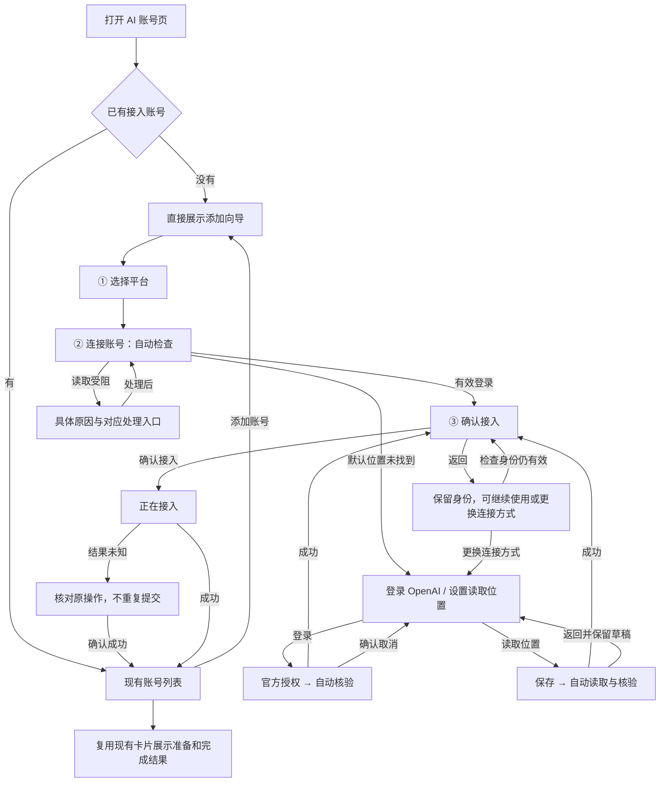

# 首次添加 AI 账号：三步向导

状态：文本流程与线框已获用户确认；2026-11-13 HTML 已获认可并纳入主预览，随后获准接入正式 React 界面。仅在 bee-desktop-ui worktree 维护。

[可交互主预览](../preview/index.html?scene=add-platform) · [现有主预览](../preview/index.html) · [历史索引](../preview/history/README.md)

## 范围与复用

新增首次添加 OpenAI 账号的向导；AI 账号列表仅展示已接入账号。无账号时直接展示平台选择，有账号时从“添加账号”进入。接入成功即回到列表，原样复用已有 OpenAI 卡片及准备、完成、暂停、额度等待、错误恢复交互，不设计第二套卡片。

OpenAI 和 Claude 是平台选项，不再作为首次添加页的空账号占位。自动发现的本机登录只是候选，用户确认且接入成功后才进入列表；已接入账号后来出现授权或读取故障仍保留。

本稿细化 OpenAI；Claude 选项链接到已有 Claude 预览流程，未重新设计 Claude 的三步向导。既有每平台单个接入选择不变；OpenAI 已接入时添加入口提示从详情换号，不模拟同平台多账号支持。

## 技术与视觉基线

- 沿用并已确认：现有 Bee 外壳、字体、浅深色语义颜色、紧凑／宽屏尺寸及账号卡片。
- 沿用：单文件 HTML、内联 CSS 和 JavaScript，以本地定时器模拟结果；无新增依赖或版本要求。
- HTML 已纳入 `docs/preview/index.html`；`draft.html` 保留为已认可来源稿。以上为预览阶段范围；后续正式实现见下方记录。
- Wokey 截图仅作为平台选择与授权区域层级参考。网站访问超时；不据截图引入设备码授权、OAuth 粘贴或新平台。

## 已确认流程

## 页面与操作

1. **选择平台**：不默认选平台。点击 OpenAI 直接进入第二步，无额外“下一步”。向导位于 AI 账号页主内容区。
2. **连接账号**：先自动检查。默认位置未找到不等于没有登录，不作为红色故障。突出“登录 OpenAI”，提供次要“设置读取位置”，不额外弹窗询问。
3. **读取位置表单**：目录输入与选择目录入口；底部只有“保存／返回”。保存自动读取并核验，返回保留目录草稿且不读取。保存成功不等于连接或接入成功。
4. **官方登录**：一次点击启动，不增加“开始官方登录”确认弹窗。有有效链接后可打开官方页面；等待授权和核验期间在原区域显示进度。核验成功自动进入第三步。
5. **确认接入**：展示真实核验的账号身份和接单影响；底部“确认接入／返回”，不重复弹窗。返回第二步保留核验身份，继续前检查是否仍有效；账号变化则展示新身份，重新确认。
6. **接入成功**：回到列表，展示已有 OpenAI 卡片。准备失败不移除账号；完成按钮只收起已有完成反馈，不作为第二次接单授权。

确无历史接单选择时明确告知“首次接入，准备完成后将自动接单”；有历史则保留最新选择，查询失败不能按无历史处理。

## 取消、失败与结果未知

- 取消官方登录先确认任务结束，再回到第二步连接方式选择；不清除已发生的官方授权。取消结果未知时只核对，不启动新任务。
- 登录超时后先确认上次任务结束，再启动新登录。失效链接不可继续使用。
- 登录未开始时可返回平台选择；已有活动登录时切换页面需先处理该任务。关闭或离开页面不能伪装为取消成功。
- 失败停留在当前步骤，保留输入及前序信息，展示本次失败点、具体原因和可用恢复动作。错误原因旁以圆圈叹号打开详情浮层，保留底层证据；支持 Escape 关闭并将焦点返回叹号入口。
- 接入已提交且结果未知时保留原操作，只核对不重提。准备阶段已经接入，不回到首次确认。

## 预览行为与验证边界

新增 38 个直接入口，原有 481 个入口保留供对照；新增向导与列表规则在“添加账号”两组评审。旧场景保留其历史布局，不视为新向导的入口。

直接选择进行中或失败场景停留；用户点击产品动作后按场景预设推进，场景选择器同步显示当前状态。重置回到最后直接选择的起点；切换场景取消旧定时任务。主题及尺寸不清除输入或弹层。

所有账号、目录、权限错误和接口结果为模拟数据。“选择目录”是页面内模拟选择器；“打开登录页面”不打开真实官方页面，随后按固定延时模拟授权和核验。这不代表真实授权已经完成，也不证明取消、身份核验或接入接口已实现。

接入权限拒绝、历史查询失败、保存失败等预设允许重试后仍失败，不能以按钮点击伪造故障修复。目录未找到场景可通过选择预设工作目录展示恢复。真实能力验收留到正式实现。

本轮浏览器验证记录见 [预览 README](../preview/README.md)。视觉与操作已获认可并纳入固定主预览。

## 正式应用实现（2026-11-13）

- `NativeAccountsPage` 按真实 `selection` 展示已接入账号；未接入时进入平台选择。已选平台跨页面保留，诊断来源定位进入对应平台，Claude 沿用已有流程。
- `AddAccountWizard` 实现三步引导，复用 `useAccounts` 的读取、官方登录、保存、接入与原操作查询。保存失败保留表单；进入确认前完成官方身份核验；身份、来源、授权有效期、运行条件或接单选择变化使原确认失效。已展示的目标保留到用户重新核验。
- 读取位置等待偏好加载完成，避免误读默认来源。目录选择新增 Tauri 官方 `plugin-dialog` 2.8.4（JS 与 Rust 均固定版本），主窗口仅新增 `dialog:allow-open`，未授予文件读取或 Shell 权限。
- 接入保留已有暂停选择。当前供给接口只返回有效 `paused`，不返回“是否首次接入”；因此文案依据已确认的有效选择说明“允许接单”或“保留暂停”，不推断不存在历史。供给读取失败或过期时禁止确认。
- 取消回执和结束事实分开处理；结果未知时继续使用原操作查询，不重启登录或重发接入。接入选择已落地后复用原 OpenAI 卡片承接准备、完成、额度和恢复。
- 测试使用隔离的原生接口 fixture，不读取真实凭据、不访问真实 Hive。验证覆盖空页、目录保存与失败、官方登录及取消、身份变化、过期、暂停、原操作查询、后台读取竞争、导航与旧卡片；生产前端构建及 macOS Rust 编译检查通过。

尚需真机验收：操作系统目录弹窗、已安装 Codex 官方客户端的真实登录与取消、真实 Hive 的接入及准备结果。接口模拟测试与编译通过不代表这些端到端能力已完成验收。
