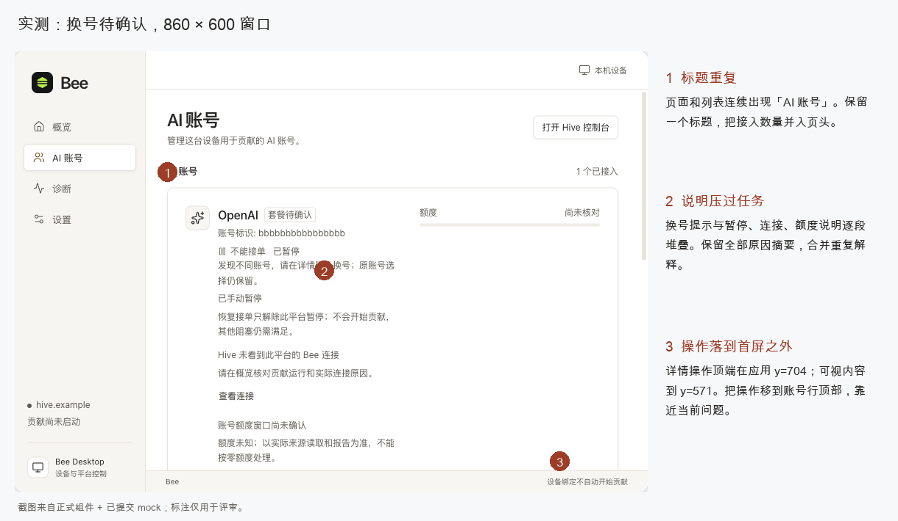
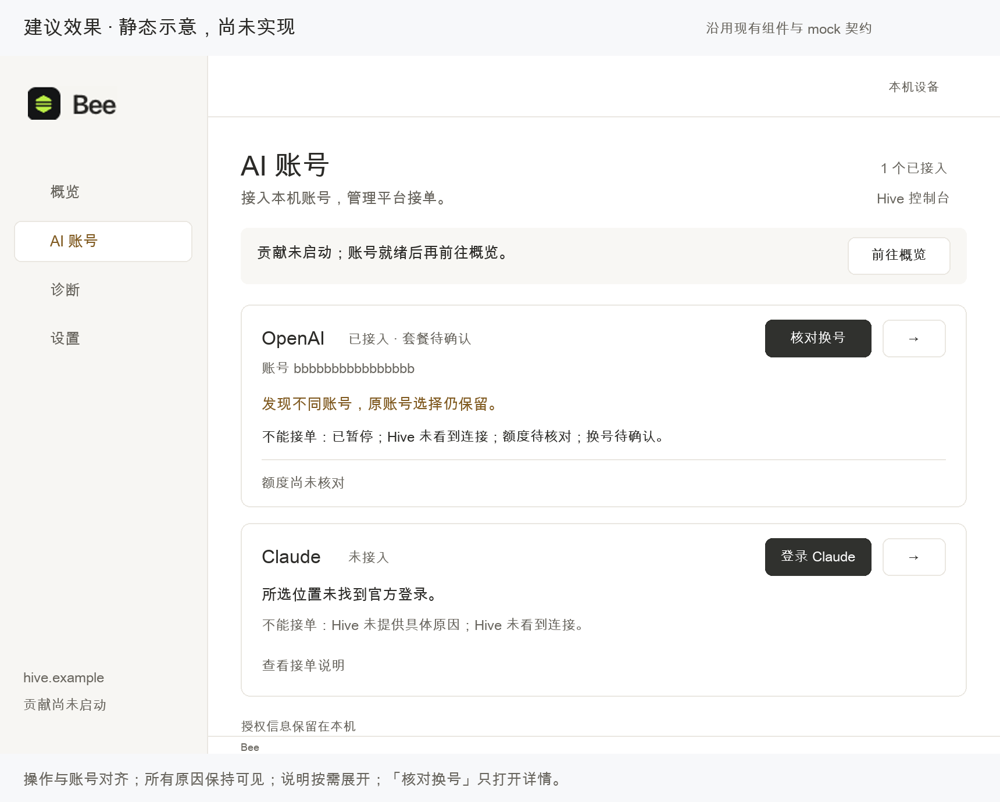

# Bee 账户页首轮体验评审与最小优化建议

> 最新进展（2026-11-05）：用户已授权实施，账户目标交互已在正式 React 页面＋有状态 mock 中落地。请先看[实施与验收记录](auto-service-validation.md)。下文是按讨论顺序保留的历史评审；“未修改应用代码”“手动开始／停止贡献”等结论仅描述各段当时的版本，不代表最新目标预览，也不替代当前原生版本的验收记录。

2026-11-04。本轮只评审账户页及其登录、接入、详情、换号和暂停恢复流程；概览仅作为开始贡献的必要交接页。**应用代码未修改，图片为建议示意，方案尚未实施。**

## HTML 讨论预览（后续补充）

### 当前阶段：先跑通前端与 mock（2026-11-05）

用户进一步明确先不接真实业务，优先验证前端逻辑。[当前规格](../../auto-service-design.md)已按此收敛：独立 HTML 用于沟通，正式前端页面、状态协调与 Client 配合既有有状态 mock 完成连续流程；真实账号、Hive、Go／Rust 运行逻辑与原生退出恢复留到后续。本轮仅更新规格，尚未据此修改 HTML 或应用代码。

后文自动运行的产品方向继续作为 mock 的目标行为；源码核查保留为后续联调依据，不属于本阶段实现或验收范围。当前验收只证明前端在指定模拟条件下的状态、按钮、反馈及恢复路径，不证明真实服务已经启动或能接单。

### 自动运行与平台接单方案（2026-11-05，尚未更新 HTML）

用户已确认取消日常“开始贡献／停止贡献”按钮的方向：Bee 运行时自动维护已接入账号，平台分别暂停／恢复接单；主动重新登录后，即使仍是原账号，也保持暂停并由用户恢复。当前前端范围与测试建议见[账户页前端交互规格](../../auto-service-design.md)。用户明确调用 `mattpocock-skills:to-spec` 后，该文件已原地改为其七节模板；此前稿件仅参考 grilling／domain-modeling／prototype，没有使用 to-spec。当前规格仍为本地草稿，未发布 issue。

当前 HTML 仍保留旧的“已接入、贡献未启动”交接，暂未按本方案改动。下文 A3、A5、旧流程实测及“开始贡献由用户明确操作”等条目保留其历史语境；后续预览不再采用前往概览启动贡献的建议。账户页单一状态、折叠原因和来源修复入口继续沿用。

#### 自动运行方案的源码核查依据

核查时 UI 分支为 `8041b94`，以下依据说明现状与缺口，不代表目标行为已实现。规格正文按 to-spec 要求不嵌入容易过期的具体实现路径，核查证据保留在本报告。

| 依据 | 已确认事实与含义 |
| --- | --- |
| [现有全局按钮](../../../../desktop/src/features/lifecycle/NativeRuntimeControls.tsx) | 当前启动传入空恢复列表；自动打开时照搬该调用不能完整保留接单选择 |
| [运行准备与平台屏障](../../../../agent/desktop_runtime_sync.go) | 现有准备会先写 Hive 暂停；已有按平台停止维护与禁新流的能力，不负责取消已建立流 |
| [官方登录](../../../../agent/desktop_authorize.go) | 当前要求全局停止；失败或取消不能证明凭据未改变，需要独立重读 |
| [恢复规则](../../../../agent/desktop_runtime_recovery.go) | 现有运行意图、未决操作和会话证据不能因自动运行而被绕过 |
| [运行测试先例](../../../../agent/desktop_runtime_test.go)、[登录测试先例](../../../../agent/desktop_authorize_test.go) | 已有真实运行逻辑配合可控 Hive、临时存储和受控官方登录辅助进程的测试设施 |
| [管理协议测试](../../../../desktopbridge/runtime_test.go) | 已有公开协议操作、可查询结果和严格参数约束；现有契约替身本身不能证明真实业务逻辑 |
| [浏览器流程](../../../../desktop/tests/native-runtime.spec.ts)、[账户页流程](../../../../desktop/tests/native-accounts.spec.ts) | 已有连续有状态 UI 测试；旧的显式启停断言需要随正式行为更新 |

Hive 协议已核对：暂停独立参与准入，注册授权不强制要求先暂停；新连接的授权信封受当前租约约束。目标转发要在可用授权发布前就绪；本机禁新流不能代替 Hive 暂停。已派发任务保留原账号与凭据绑定，登录维护不需要额外新增主动断流机制。

### 单一主状态与折叠原因（2026-11-05，已用于 HTML 原型）

用户已明确：每个账号只突出一条主状态，原因与错误详情默认折叠，展开后遵循“同因去重、独立条件保留”。这替代此前“所有阻塞原因在列表常显”的建议；正式组件尚未修改。

- 权限不足指系统拒绝读取 Codex 登录文件，不是接单开关。手动暂停指用户主动停止该平台接收新任务，两项条件可以独立成立，也分别解除。
- 只有手动暂停时显示“已暂停接单”，不再追加“已暂停”；存在权限错误时主状态显示“不能接单”，原因收进“查看原因（数量）”。报告过期优先显示“状态待更新”，历史暂停标为“上次记录”，不冒充当前事实。
- 展开后，权限错误只保留“无法读取 Codex 登录文件：系统拒绝访问”；同时有手动暂停时另列一项。修复指导、检查证据和恢复后的注意事项也在该展开区，不再到处重复渲染错误。
- 账户行保留暂停／恢复及详情入口。用户进一步确认：移除含义模糊的“检查登录来源”主按钮，改为折叠原因中的次级入口“打开读取设置”；该入口打开并定位到凭证读取方式，不执行独立检测，也不授予系统权限。明确信息不足时不声称“可接单”。
- 入口调整后已验证：键盘展开原因后可打开读取设置并聚焦目录；详情内再次定位会展开已收起的设置、保留输入；Escape 返回原次级入口；模拟权限恢复后入口消失。860×600 下无横向溢出。
- 列表与详情共用原因内容；当前会话中的展开选择在操作更新后保留，切换或重置场景后默认收起。“凭证读取方式”仍在详情默认展开，此次折叠的是原因。
- 换号场景改用“换号说明”：触发条件仅为本机读取到的账号身份与已接入账号不同。“已暂停接单”和“贡献尚未启动”在同一折叠区内单列为“接单条件”，不再被呈现为发现不同账号的原因；不重复追加“账号变更待确认”作为原因。
- 本次局部验证：键盘展开换号说明、列表与详情的接单条件一致、860×600 无横向溢出；明确确认后当前账号变为目标账号，贡献仍未启动且暂停保留。截图 `html-change-explanation.png` 展示修正后的说明层级。
- 已在浏览器验证 8 个场景各账号只有一条主状态、原因默认折叠；验证权限失败 → 暂停 → 展开两项原因 → 修复权限后仍暂停 → 明确恢复后可接单；验证键盘展开、Escape 焦点返回、列表与详情一致、860×600 浅色和 1120×760 深色布局无横向溢出。验证仅针对独立 HTML 原型。
- 单一状态方案截图：`html-status-collapsed.png`、`html-status-expanded.png`、`html-status-dark.png`。这些截图保留移除主修复按钮前的状态。入口下移后的截图为 `html-source-action-collapsed.png` 与 `html-source-action-expanded.png`。原有截图保留为此前方案与正式组件基线证据。
- 术语记录在根目录 `GLOSSARY.md`。本次呈现调整可直接撤回，不创建 ADR。

当前正式产品文档仍规定“标题下列出全部原因／多条原因全部可见”（`product.md:207,221`）。本次用户决策已明确调整账户页的展示方式；落地正式组件时须同步这些条款，并区分概览范围，不能继续按旧规则验收 HTML 原型。

按用户要求增加 [账户页 HTML 预览](accounts-preview.html)，用于点击、比较和沟通布局。它是独立原型，HTML、样式、示例状态和图标均放在同一个文件里；没有接入正式应用或修改 mock。原型中的模拟登录完成／读取恢复不代表 M1–M3 已补齐。

- 可切换 8 种账户状态、浅色／深色、860×600／1120×760，并重置当前状态。
- 可打开详情、查看新旧账号、确认接入／换号、暂停／恢复；Escape 关闭并返回触发入口。
- 外部条件由应用画框外的模拟按钮控制。概览／设置／诊断／Hive 只说明交接位置，本轮不扩展这些页面。
- “显示讨论标注”显示 ① 页头、② 账号行、③ 操作区、④ 详情，方便按区域反馈。
- 已在浏览器检查换号后恢复／暂停、登录完成后接入、来源恢复、报告过期／核对完成、明暗主题、两种尺寸和确认框 Escape 焦点返回。未发现水平溢出；这些结果只验证本原型。

直接用浏览器打开 HTML 文件即可，或启动本地预览：

```sh
python3 -m http.server 1487 --bind 127.0.0.1 --directory /Users/dayong/myspace/mywork/tokenhive/.worktrees/bee-desktop-ui/docs/desktop/evidence/2026-11-04-account-ui-review
```

访问 `http://127.0.0.1:1487/accounts-preview.html`。状态、主题和尺寸写入 URL；操作过程只保存在内存，刷新会重置。

## 基线与隔离

- UI worktree：`/Users/dayong/myspace/mywork/tokenhive/.worktrees/bee-desktop-ui`
- UI 分支：`feat/bee-desktop-ui-review`
- 来源：`feat/bee-desktop-p0` 已提交版本 `50e8a6b`
- 原 mock worktree 有未提交改动，本次未复制。下文缺口仅针对上述提交，不能用于判断另一会话正在补齐的版本。
- 实测：Node 24.22.1、Vite 正式 `NativeApp` + 现有模拟 IPC，Ego 浏览器；中文浅色参考窗口、860×600 中文浅色／英文深色，以及直接应用页的大窗口。
- 依赖通过锁文件安装，仅在新 worktree 生成忽略的依赖目录。没有更新锁文件或修改 mock。

## 结论与建议效果

保留已有银白、系统字体、深色主按钮及琥珀色强调。优先修复“当前状态与旧成功反馈冲突”，然后把账号的关键问题与操作放在一起，减少重复解释。当前大部分拥挤来自文字层级和操作布局，而非缺少新的配色或组件库。





原建议图（在 11 月 5 日原因折叠调整之前）与实测图对应同一个 `account-change` 场景：OpenAI 发现新候选、贡献停止；Claude 尚未接入。示意图省略部分装饰图标，不表示删除正式图标。图外标题和说明不进入产品。

## 问题、优先级与最小方案

P1：先修，当前事实可能被误读。P2：本轮账户页优化应完成。P3：视觉收尾。

| 编号 | 级别 | 具体问题与影响 | 最小改进 | 证据／定位 |
| --- | --- | --- | --- | --- |
| A1 | P1 | 接入后启动贡献并恢复接单，账号已显示“可接单”，旧提示仍写“接入已完成，该平台保持暂停”。历史结果与当前状态矛盾。 | 完成反馈仅陈述“账号已接入／换号已完成”；当前暂停事实由最新供给状态呈现。仅完成反馈可短暂显示，未决／失败信息必须持续可见。 | `06-resumed-stale-message.png`；`NativeAccountActions.tsx:23`、`:26` |
| A2 | P2 | 操作单独占网格下一行，排在左侧长说明之后。860×600 换号场景中，OpenAI 详情操作顶端 y=704，可视主内容底部 y=571；Claude 整行继续下移。 | 身份、关键状态、动作在同一行顶部对齐；额度置于下一层。发现换号时在问题旁显示“核对换号”，打开现有详情，不直接提交。详情中把换号／重新登录放到来源表单前。 | `07-change-narrow.png`、`08-change-details-narrow.png`；`app.css:279`、`:299`；`NativeAccountDetails.tsx:52` |
| A3 | P2 | 尚未接入时，登录／接入任务被“不能接单”“联系管理员”“Hive 未看到连接”等多段解释包围；接入后“查看连接”承担了去开始贡献的导航，但按钮不能表达下一步。 | 首先说明“未找到登录／已有登录待接入”。保留一条主状态，全部独立原因与必要解释默认折叠，展开后同因去重。贡献明确停止时，只给一处“前往概览”引导。有账号问题先提示处理；账号就绪后说明开始贡献与恢复接单的顺序，不能承诺开始后必然可接单。 | `01-empty.png`、`02-candidate.png`、`04-selected-stopped.png`；`NativeAccountList.tsx:43`、`:46` |
| A4 | P2 | 同一权限失败同时出现“来源暂不可用”、接单原因和独立错误块，且有两个“检查凭证来源”按钮。 | 针对同一平台、同一检查事实合并展示。主状态只显示一条；折叠原因区保留具体失败与检查证据，展开后可通过“打开读取设置”定位修复。不同原因不得合并丢失。 | `09-read-error.png`；`NativeAccountList.tsx:44`、`:46`、`:47` |
| A5 | P2 | 接入确认解释了注册和保持暂停，却没有直说贡献会使用所选账号的订阅额度。 | 确认框列明目标账号／平台、使用订阅额度、接入后保持暂停，以及暂停影响同一 Hive 用户下该平台；开始贡献与恢复接单需另行操作。保留当前确认门禁。 | `03-select-confirm.png`；`NativeAccountActions.tsx:14`；对照 `product.md:11`、`:144` |
| A6 | P2 | 详情里的当前账号和候选账号相同时重复显示同一个前缀；正常操作在来源设置后。 | 相同候选不重复列一条身份；不同候选保留完整的“当前／目标”对比与确认。身份、授权到期、额度重置和当前动作优先，来源配置随后。 | `05-details.png`；`NativeAccountDetails.tsx:38`、`:41`、`:52` |
| A7 | P3 | 页头和列表连续重复“AI 账号”；套餐列表为 `Plus`，详情为 `plus`；说明、原因、辅助文字大多同色同级。 | 只保留页头标题，接入数量放右侧；套餐显示统一；主要状态 13px 正文色，辅助说明 12px 次要色。继续沿用现有 token，不引入字体或设计依赖。 | `02-candidate.png`、`05-details.png`；`NativeAccountList.tsx:22`、`:40`；`NativeAccountDetails.tsx:38` |

上述账户组件位于 `desktop/src/features/accounts/`；`app.css` 位于 `desktop/src/styles/app.css`，`product.md` 位于 `docs/desktop/product.md`。这是正式组件问题清单，不将模拟命令不完整归为上述界面问题。

## 账户页流程实测

| 步骤 | 实际结果 | 判定 |
| --- | --- | --- |
| `account-empty` → 登录 OpenAI → 确认官方登录 → 取消 | 能打开确认框、进入等待、取消后回到可继续登录；没有打开真实官方登录 | 模拟启动／取消已走通；完成受 M1 阻塞 |
| `account-empty` → 登录 Claude → 继续登录 | 行内显示系统终端与官方页面指引，并有取消入口 | 启动反馈可用；终端和完成未验证 |
| `account-candidate` → 接入 → 确认接入 | 1 个已接入、平台暂停，写调用仅一次 | 已走通 |
| 接入 → 查看连接 → 概览开始贡献 → 返回原处 | 返回账户页，暂停保持，需要明确恢复 | 已走通；导航文字需改进 |
| 恢复接单 → 暂停接单 | `supply_set_paused(false)` 后可接单，再 `true` 后暂停；另一平台暂停值未改变 | 已走通；发现 A1 |
| OpenAI 详情 → Escape | 关闭详情并将焦点返回“OpenAI 详情”按钮 | 已验证 |
| `account-change` → OpenAI 详情 → 换号 → 确认更换 | 当前 `bbbb…`、目标 `ffff…`；确认后变为目标，暂停保持；`confirm_change` 仅一次 | 已走通 |
| `account-error` → 检查凭证来源 | 打开对应平台详情，展开来源区，焦点落到目录输入框 | 恢复入口已走通；实际恢复受 M2 限制 |
| 860×600 中文换号、英文深色已接入 | 未观察到页面横向溢出；长说明将后续操作推到首屏外 | 有尺寸和主题实测；非全矩阵验收 |

接入／暂停／恢复／换号都只影响隔离预览。没有测试真实 Hive、官方账号、macOS 系统终端或原生菜单。没有把截图场景切换当成连续业务完成。未修改应用代码，因此没有运行与本轮无关的完整测试套件。

## Mock 依赖与验证边界

| 编号 | 基线缺口及证据 | 合入后复验 |
| --- | --- | --- |
| M1 | 登录成功缺少可连续推进的预览路径。`authorize_start` 将操作置为 running；预览覆盖了 `runtime_snapshot`、`account_detect`、`account_snapshot`，绕过共享 fixture 的 `finishLogins()`。实测设置已有测试钩子 `loginComplete=true` 后，Claude 仍 running，调用记录只有 `authorize_start`；这不是“官方登录失败”。源码：`tests/fixtures/bee-preview/fixture.mjs:135`、`:141` 与 `tests/fixtures/native-accounts.mjs:14`、`:98`。 | 从空账号登录完成 → 自动核验候选 → 明确接入；取消、超时、缺少客户端及失败后重试。使用 mock 会话的正式结果控制，不直接改账号数据冒充成功。 |
| M2 | `account-error` 的来源读取结果固定；预览的 `account_detect` 直接回读固定对象，目录修改不能驱动权限恢复和新候选。这轮只证明入口及焦点有效。 | 同一会话：权限失败 → 修复来源／权限 → 重新读取 → 正确候选；保留输入，拒绝旧来源迟到结果。 |
| M3 | 接入／换号 fixture 主要立即成功；本轮没有验证写入响应丢失、结果待确认和真正恢复成功的连续路径。 | 待确认时禁止重放写入；恢复后只更新原操作结果，不自动换号、开始贡献或解除暂停。 |

上述缺口与人工实测记录来自 `50e8a6b`，保留为历史证据。11 月 4 日已将 p0 的已提交更新快进合入 UI 分支至 `48dce01`，类型检查、49 项 mock 测试及 5 项账户流程测试通过；p0 未提交修改未纳入。独立 HTML 操作仍不代表正式组件完成全部人工复验。UI 分支未合入 main。

## 最小设计与取舍

推荐“紧凑账号行”：沿用现有两平台列表与详情，改变顺序和文字层级。能力完整，业务规则不变，前端改动范围最小，无新增依赖。

对比两种备选：并排大卡片在 860px 下给原因和英文留下的宽度更少；跨页分步向导会增加往返路径，维护已接入账号时不够直接。本轮继续采用账号行；按 11 月 5 日最新讨论，在首次使用和故障恢复等有顺序依赖的任务中，行内展示当前必要步骤，正常、等待和单步操作不常驻步骤条。

沿用技术栈：Tauri 2、React 19、Radix UI、Lucide 与现有 CSS token；无新增选型。本轮图像只是设计讨论材料，不需要新路由、测试替身或组件抽象。

建议尺寸继续基于产品约定：侧栏 178px、顶栏 52px、主内容左右 29px；标题 24px、平台名 16px、正文 13px、辅助 12px；按钮高 32px、圆角 6px。沿用 `#ffffff` 工作区、`#f7f8fa` 背景、`#2c2b28` 正文、`#69665f` 辅助、`#30312e` 主按钮、`#ba8d49` 强调。落地时验证所有状态文本对比度，不以放大整个界面解决拥挤。

必须保留的边界：

- 一条主状态常显；全部实际独立原因可在折叠区展开查看，同因去重。有顺序依赖的任务通过当前步骤直接进入修复；具体原因和证据保留在折叠区，避免重复同一操作入口。未知额度不画成零用量。
- 只有当前可信报告能证明可接单；不删报告失效、失败或结果待确认提示。
- 当前已批准产品说明要求详情“凭证读取方式”默认展开。本轮先把它移到关键动作之后，保留默认展开及错误定位自动展开；不默默改成折叠。
- 同账号不重复展示候选，不等于隐藏换号时的目标身份。授权到期未知仍显示“未知”。
- 登录、接入、换号、开始贡献、解除暂停仍由用户明确操作。运行时“暂停接单”始终保留，不能因需要恢复授权就隐藏安全暂停入口。
- 详情和弹窗继续支持 Escape、焦点约束和焦点返回。故障恢复先展示具体原因，再给匹配入口。
- Hive 控制台仍保留为次级链接；不新增已注册账号完整移除功能。

## 后续账户页验收门槛

先完成 A1，再做 A2–A7 的局部调整；不扩展其他页面视觉改造。后续必须验证：同一账号连续接入／开始／恢复／暂停后的状态互不矛盾；新旧账号确认正确；来源失败能恢复继续；窄窗主要动作可见；所有原因可展开读取且无需横向滚动；中英文与明暗主题；键盘焦点。M1–M3 补齐前只能报告已覆盖范围，不能称账户页完整验收通过。

## 证据目录

- `01`–`10` PNG：原始截图。`02`–`06` 为直接应用大窗口；`01`、`09` 为预览参考窗口；`07`、`08`、`10` 的 App 内部尺寸为 860×600。
- `annotated-current.png`：对 `07` 的 App 区域裁切并加标注，未修改截图内容。
- `proposal-accounts.png`：静态建议示意，保留完整 App 上下文，没有接入应用代码。详情示意沿用箭头入口，正式可访问名称继续包含平台。

## 一致性检查

- ✅ 对话：账户页优先、独立 worktree、仅已提交 mock、暂不改应用代码；未恢复已放下的配对页评审。
- ✅ 文档内部：实测、方案与缺口分别标明；当前状态、历史反馈、账号选择与暂停含义一致。
- ✅ 横向：问题对应现有组件与截图；建议图包含全部当前原因，保留换号确认及控制台入口；不存在实现／PR／接口改动需要同步。
- ✅ 配置：无新配置、无依赖升级；以独立端口运行基线，未复用另一会话服务。
- ✅ 产品文档：沿用既有样式、平台数量、贡献与暂停边界；保留来源默认展开、授权到期和未知状态；原因默认折叠按 11 月 5 日用户决定执行，正式产品文档待落地时同步。
- ❌ 完整流程验收尚未完成：M1–M3、真实官方登录和原生系统验收未完成；没有将其宣称为通过。

结论：评审材料与证据一致；建议未实施，mock 依赖待后续提交整合。


### 2026-11-05 增量一致性检查

- ✅ 对话：采用用户指定的一条主状态、原因默认折叠；仅修改原型与记录，未扩展页面。
- ✅ 文档内部：此前常显建议已替换；旧实测、旧截图和旧 mock 缺口标明基线，新截图与本次验证单列。
- ✅ 横向：HTML、术语及此记录一致；原型无新接口，未修改正式应用，也未创建 PR。
- ✅ 配置：仍使用原 1487 预览地址，无新增依赖或环境变量，不涉及其他环境配置。
- ✅ 文档与行为：展开后保留所有独立条件，权限修复不自动解除暂停；来源配置仍默认展开。正式产品文档的旧展示条款明确记录为落地待同步项。

## 2026-11-05 按任务展示步骤（用户已确认）

展示依据是“当前任务是否需要依次完成操作”，同时覆盖首次使用和故障恢复。账号、贡献、连接、平台暂停和操作结果仍分别判断；步骤只描述当前需要走的路径，不替代完整业务状态机。仅更新独立 `accounts-preview.html`，不修改正式 UI、mock 接口或其他会话的源码改动。预览沿用本轮已核对的手动启停交互，后续运行机制的设计不在本轮改动范围。

- 首次接入：本机登录 → 确认接入 → 启动贡献 → 连接同步 → 恢复接单。已有登录直接标记对应阶段；成功后隐藏步骤，日常暂停不会重新出现首次引导。
- 权限恢复：修复读取 → 核验登录；平台手动暂停时追加“恢复接单”。读取恢复进入核验阶段，不直接冒称可接单。贡献已停止时补入启动和连接同步。具体权限证据和独立暂停事实默认折叠；读取设置通过当前步骤直接打开。
- 授权过期：按当前情况展示停止贡献、重新登录、核验账号、启动贡献、连接同步；需要解除手动暂停时才追加恢复接单。相同账号保留身份；不同候选仍须进入确认换号。
- 换号：核对账号 → 确认换号 → 按需启动贡献 → 同步核验 → 恢复接单。原账号在明确确认前保留；“换号说明”下的本机贡献与平台接单作为当前运行事实，不是换号原因。移除旧“接单条件”固定清单。
- 可接单、单纯手动暂停、日常停止贡献、自动重连、额度等待、报告过期以及结果待核对不显示步骤条。未知写结果仅核对原操作；不能将再次换号或重新登录当作重试。
- 可接单依赖最新条件；启动、修复、核验、解除暂停各自只推进对应环节。模拟连接完成与账号同步完成由预览控制区提供，不表示正式 mock 已补齐。

### 本次验证

14 个预设场景通过主状态、步骤显示规则、默认折叠及窄窗无横向溢出检查。连续操作已验证：

1. 官方登录完成 → 核验 → 明确接入 → 明确启动 → 连接同步 → 明确恢复 → 可接单；再次暂停不重现首次步骤。
2. 权限不足＋手动暂停 → 展开两项独立原因 → 打开读取设置并保留自定义目录 → 模拟修复 → 核验 → 仍暂停 → 明确恢复；账号身份保留。
3. 核对新旧账号 → 明确确认换号 → 目标账号更新 → 明确启动 → 连接同步 → 仍暂停 → 明确恢复。
4. 授权过期且贡献仍运行 → 明确停止 → 官方登录 → 核验同一账号 → 明确启动和同步；原先未暂停时不强制新增解除暂停步骤。
5. 自动重连期间手动暂停 → 网络恢复 → 同步核验 → 保持手动暂停，核验完成前无恢复入口。
6. 换号结果未知 → 详情无再次写入入口 → 只读核对原结果 → 模拟原操作成功 → 同步 → 保持暂停。

脚本两段 JavaScript 均通过语法解析。以上为独立 HTML 的模拟交互验证，不等于正式组件或真实官方登录验收。首次浏览器验证的换号定位器匹配两个按钮，改用唯一可访问名称后完成验证；不是产品操作失败。

额外检查 8 个深色宽窗场景，未发现横向溢出、步骤标签裁切或重复主状态。键盘 Enter 可展开原因；来源入口聚焦目录，Escape 返回原入口；换号详情更新后仍返回正确的可访问按钮。

截图：`html-task-change.png`、`html-task-ready.png`、`html-task-source-recovery.png`、`html-task-expired.png`、`html-task-dark-wide.png`。旧截图保持原样，代表之前的展示方案。

### 本轮一致性检查

- ✅ 对话：按已确认的“有顺序依赖才展示步骤”执行，同时覆盖首次接入与故障恢复；没有恢复常驻四节点的旧建议。保留一条主状态、原因折叠和同因去重。
- ✅ 文档内部：布局取舍与新增规则一致，原始基线和旧截图明确保留为历史证据，当前截图单列。接入、贡献运行、平台暂停和可接单含义分别保留。
- ✅ 横向：HTML 与已核对的恢复门禁一致，启动与连接同步前不能解除暂停；术语区分接入和可接单。无 Plan、PR 或新接口需要传播，无正式源码改动。
- ✅ 配置：继续使用 1487 原预览服务，无新增依赖、环境变量或配置模板变更。
- ✅ 文档与行为：14 个预设场景、6 条连续流程、深色宽窗和键盘结果按实际验证记录；原型能力不冒充正式 mock 或真实官方登录能力。

结论：预览和记录一致。正式组件、完整业务状态机以及后续运行机制仍需后续整合验收，未在本轮宣称完成。


## 2026-11-05 当前步骤可直接操作

当前可执行步骤采用原生按钮，数字、名称和动作提示组成同一个点击区域（至少 44 × 44px）。例如“修复读取／打开读取设置”直达对应平台的来源目录；“核对账号／查看新旧账号”打开身份对比。自动核验、连接同步和等待官方登录只显示进度；已完成和后续步骤不提供跳步按钮。

- 登录、接入和换号仍打开原有确认框；启动／停止步骤交接到概览，预览控制区模拟后续结果。修复不自动恢复接单。
- 当前步骤承担主要操作后，移除行内和详情中同一动作的重复按钮；安全暂停、详情入口继续保留。具体原因与独立条件仍默认折叠。
- Escape 返回触发按钮；步骤发生推进时返回新的当前步骤。确认接入／换号后聚焦下一步；完成任务后步骤消失。
- 沿用现有主题和原生控件，无新增依赖。详情窄栏的六步流程分成两行，减少标签换行。

验证：14 个预设场景均只有一条主状态；步骤按钮只出现在当前可执行节点，后续步骤无按钮，无窄窗横向溢出，点击区域达到 44px。连续验证了读取恢复＋手动暂停、接入、换号、授权恢复；点击数字和文字均生效，Enter／Space、确认取消、Escape 及焦点返回通过。自动阶段没有可误触的步骤按钮，完成后隐藏引导。浅色窄窗、深色账号行、详情和六步详情均已截图检查，两段 JavaScript 通过语法解析。场景巡检脚本曾引用不存在的摘要选择器，修正后完成检查；非页面操作失败。

截图：`html-clickable-steps-source.png`、`html-clickable-steps-change-dark.png`、`html-clickable-steps-change-sheet.png`、`html-clickable-steps-six-step-sheet.png`。

仅更新独立 HTML 与评审记录；以上是原型验证，不代表正式组件或真实登录验收。其他会话的自动服务设计不在本次改动范围。
