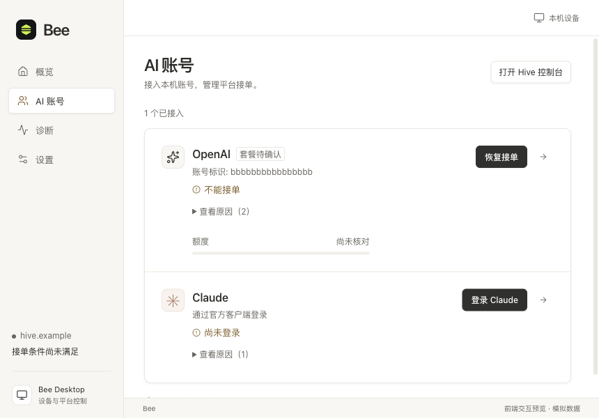
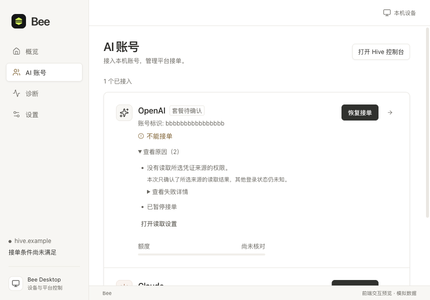
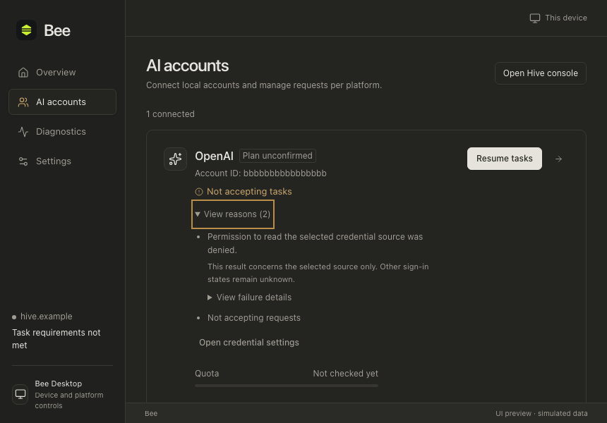

# 账户页目标交互：实施与验收

2026-11-05。用户批准[前端 mock 规格](../../auto-service-design.md)并授权“检查一下，没有问题就实施”。5 项本地任务已完成；未发布外部 issue，尚未合并到最终分支。

## 结果与范围

实现位于 `.worktrees/bee-desktop-ui` 的 `feat/bee-desktop-ui-review` 分支。正式 React 页面、共享状态与类型化 Client 接入既有模拟 IPC；目标行为仅在开发预览的 `accounts-auto-*` 场景启用。独立 HTML 同步为讨论材料。Go、Rust、Tauri 和真实 Hive 未修改。

- 接入后自动准备服务，平台保持暂停；正常使用仅分别暂停／恢复接单。目标预览的概览不再提供日常“开始贡献／停止贡献”。
- 主动重新登录只暂停目标平台；原账号登录成功、确认更换账号后均保持暂停。不同身份必须明确确认。
- 每账号一条主状态，历史完成提示不覆盖当前状态。原因默认折叠，同因去重；权限不足和手动暂停作为两项独立条件保留。
- “打开读取设置”定位到目标平台目录输入；输入保留，修复权限后仍暂停。相同候选身份不重复显示。
- 断线重连、同身份后台刷新及同会话模拟重启保留平台暂停选择；过期报告不宣称可接单；写入回执丢失通过读取原结果核对，不重放写入。
- 沿用现有字体、配色与组件 token，区分主次按钮，移除重复列表标题。修正窄屏下展开原因与主状态的样式冲突。

## 交互预览

运行 `npm --prefix desktop run dev:ui`，在“账户目标交互（mock）”分组选择场景。默认端口为 1420；以下本次运行链接使用 1489。

- [候选接入 → 自动准备 → 暂停恢复](http://127.0.0.1:1489/tests/fixtures/bee-preview/index.html?scene=accounts-auto-candidate&theme=light&size=narrow)
- [权限不足＋暂停：单一状态与折叠原因](http://127.0.0.1:1489/tests/fixtures/bee-preview/index.html?scene=accounts-auto-error&theme=light&size=narrow)
- [两平台正常：重新登录与换号](http://127.0.0.1:1489/tests/fixtures/bee-preview/index.html?scene=accounts-auto-running&theme=light&size=narrow)
- [独立 HTML 讨论预览](accounts-preview.html)

控制面板负责模拟外部结果；用户动作仍通过页面按钮完成。同一场景中连续操作，切换场景或重置会重新初始化。模拟条件的用法及启动命令见[桌面开发说明](../../../../desktop/README.md)。

## 任务与验证映射

| 本地任务 | 完成内容 | 证据 |
| --- | --- | --- |
| 01 HTML 预览 | 移除日常贡献启停；接入、换号、登录接上自动准备，随后保持暂停；保留折叠原因与修复入口 | HTML 中人工连续接入；既有键盘与来源修复交互保留；正式页面另行验收 |
| 02 接入到暂停恢复 | 候选确认、额度用途、自动准备、暂停、恢复及准备失败重试 | 新增浏览器用例 1、9 |
| 03 重新登录与换号 | 原账号仍暂停；新身份需确认；另一平台独立；失败可重试，取消后拒绝迟到成功 | 新增浏览器用例 3、4；现有账号回归 |
| 04 原因与权限修复 | 两项原因默认折叠，权限错误去重；进入读取设置、保留输入、重新读取、修复后仍暂停 | 新增浏览器用例 2、8；中英文浅深色截图 |
| 05 断线与状态恢复 | 重连、后台刷新、模拟重启、过期报告、恢复／接入回执丢失 | 新增浏览器用例 5、6、7；现有状态与 mock 单测 |

新增用例位于 [`preview-auto-accounts.spec.ts`](../../../../desktop/tests/preview-auto-accounts.spec.ts)。测试使用正常页面动作和预览外部条件控制，不以切换截图代替流程推进。

## 检查结果

在 `desktop/` 目录执行；未新增依赖。

| 检查 | 命令 | 结果 |
| --- | --- | --- |
| 正式场景浏览器回归 | `./node_modules/.bin/playwright test --config playwright.preview.config.ts --reporter=line` | 93 项通过 |
| 状态与 mock 单测 | `node --test tests/previewAccounts.test.ts tests/previewRuntime.test.ts tests/nativeAccounts.test.ts tests/desktopStatus.test.ts tests/previewDevice.test.ts` | 68 项通过 |
| 最后状态文案与布局修正后的定向回归 | `./node_modules/.bin/playwright test --config playwright.preview.config.ts preview-auto-accounts.spec.ts --reporter=line` | 9 项通过 |
| 最后修正后的类型检查与生产构建 | `npm run build` | 通过；保留已有产物超过 500 kB 的提示 |

完整 93 项回归在最后的主状态文案／布局修正前通过；修正后重跑受影响的 9 项和构建，未声称整套回归在该修正后再次执行。命令输出保存在本目录的 `validation-*.txt`。

浏览器人工检查覆盖浅色中文和深色英文 860×600，核对收起／展开原因、主状态、主要动作及横向溢出；自动化另覆盖输入、键盘展开、Escape、平台隔离及恢复路径。此结论不等于所有主题、语言与场景组合的完整矩阵验收。

## 界面问题与 mock 补充

界面修复包括重复状态、历史成功信息干扰、来源入口定位、相同身份重复、主次动作及窄屏布局。历史评审 A1–A7 中有关“先去概览开始贡献”的建议已被新规格替代；早期截图不代表当前目标流程。

沿用 p0 已提交的模拟能力，本轮补充自动准备时序、原账号重新登录、后台同身份刷新、准备失败／重试、同会话重启、过期报告与丢失回执控制。准备结果绑定来源修订与账号身份，旧结果不能覆盖新状态。另修正模拟 503 响应缺少重试诊断证据的问题，使现有前端重试策略能正确处理。以上均为测试替身能力，不代表真实后台已支持。

历史 M1–M3 中本阶段依赖的模拟路径已覆盖：登录完成／失败／取消、来源修复、写回执核对。真实官方登录、真实凭据权限、Hive 准入、已派发任务收尾、进程退出和磁盘恢复仍需后续联调。模拟重启只在当前会话保留状态。

## 一致性检查

- ✅ 对话：遵循账户页优先、前端 mock、自动准备、登录后暂停、错误折叠与去重的已确认决策；未恢复被否决的日常贡献启停方案。
- ✅ 文档内部：规格、开发说明与本记录统一标明 mock 阶段已实现；早期评审明确为历史记录，目标交互与现有原生行为分开说明。
- ✅ 横向：5 项任务对应真实页面、共享状态、模拟 IPC 与验证用例；`autoService` 传递到呈现及动作门禁，默认调用保留现有原生规则。未创建 PR，无 PR 描述待同步。
- ✅ 配置：无需新增环境变量或配置模板；目标行为受开发模式、预览路径和场景前缀共同限制，正式构建不启用。
- ✅ 文档与行为：启动入口、场景、外部条件控制和测试结果与源码及实际输出一致；不将模拟结果记为真实业务通过。

结论：本次前端 mock 阶段完成；真实业务与原生生命周期属于明确延期范围。
