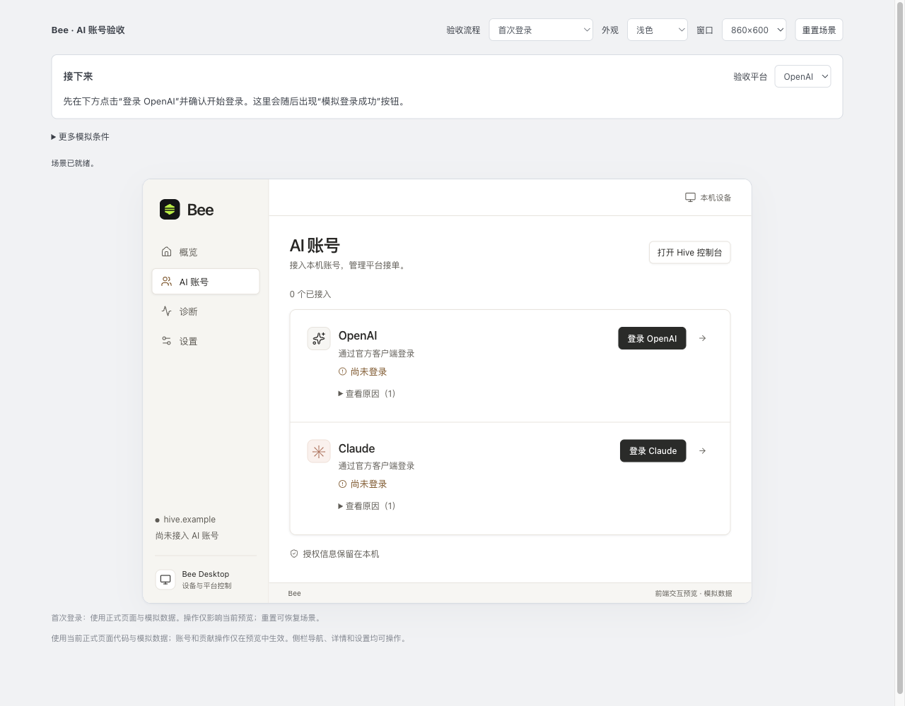
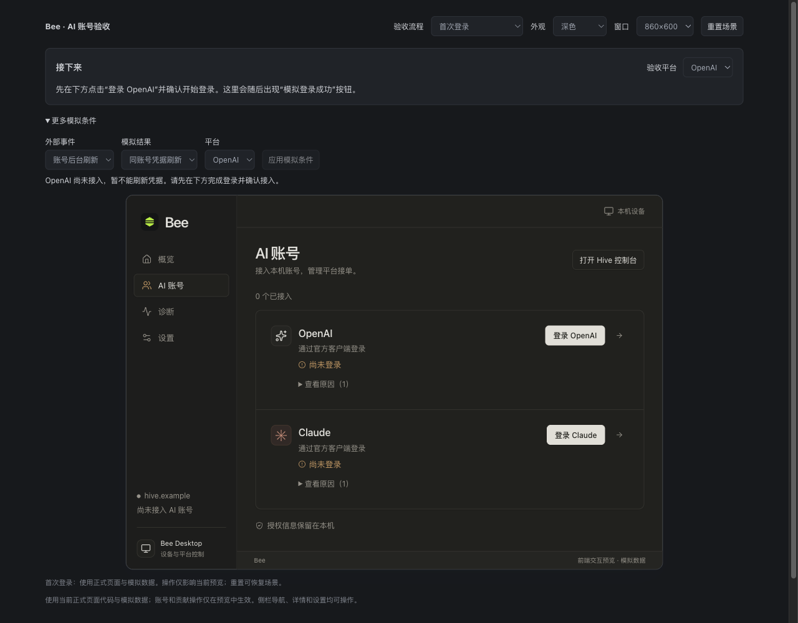

# 账户验收入口修复

2026-11-05。用户反馈模拟条件经常更新失败，且不清楚操作顺序。本次只修改预览入口、测试替身提供的只读上下文和相关回归测试；不改变 Bee 产品规则。

## 复现与原因

在 `accounts-auto-empty` 中选择“账号后台刷新”并应用，返回 `PREVIEW_REFRESH_BLOCKED: selected=not_selected; source=false`；未开始登录时应用“登录成功”，返回 `PREVIEW_LOGIN_STALE: operation=null`。两项操作当时都可点击，没有前置条件或下一步提示。

接口正确拒绝了不成立的操作；预览器仅知道事件名称和历史登录操作编号，未根据当前账号与操作状态决定按钮是否可用。首次回归测试在 `expect(#event-apply).toBeDisabled()` 失败，证明能覆盖这一问题。

## 修复

- 从账户目标场景链接打开时，只列出 7 个账号场景；账号相关模拟条件默认折叠。
- 顶部指引根据当前平台进度更新。开始登录后才出现“模拟登录成功”；读取被拒绝时提供“模拟权限恢复”，作用于当前读取来源。
- 未接入不能后台刷新；没有进行中的登录不能提交登录结果；操作结束或取消后移除快捷按钮并禁用旧结果提交。原有接口对过期操作的拒绝继续保留。
- 高级来源输入检查绝对路径；不可用动作旁显示具体下一步。选择事件或参数时清除旧反馈；提交期间禁用参数，成功后收起模拟条件并保留反馈。
- 普通接入、暂停与恢复仍通过正式页面操作。快捷权限修复不解除暂停，重新登录快捷成功沿用原账号。

## 验证

在 `desktop/` 执行：

| 检查 | 结果 |
| --- | --- |
| `./node_modules/.bin/playwright test --config playwright.preview.config.ts --reporter=line` | 96 项通过，包括账户入口的 12 项用例 |
| `node --test tests/previewAccounts.test.ts tests/nativeAccounts.test.ts` | 20 项通过 |
| `node --check` 检查 viewer、session 和 native-accounts 模拟脚本 | 通过 |
| `git diff --check` | 通过 |

新增流程验证：未满足条件时按钮禁用、旧反馈清除、首次登录→快捷模拟成功→接入→恢复接单，以及修改来源目录后快捷权限修复仍命中当前来源并保留暂停。

账户自动化的外层浏览器使用 1280×1000，以容纳验收工具栏；内部应用仍保持 860×600。另在 1280×720 人工验证外层滚动和详情重新登录入口，并检查浅色、深色与键盘焦点。没有把扩大外层浏览器尺寸当作扩大应用的窄窗尺寸。

一致性：对话范围、当前状态与按钮条件、模拟事件接口、开发预览配置、文档与实测结果均已核对。真实业务与原生生命周期不属于本次验证范围。

## 2026-11-05：简化人工验收

默认账户入口只保留“接入账号”“暂停与恢复”“故障恢复”三个项目，以及根据当前账号更新的下一步。场景选择和外部事件仅在 `debug=1` 调试模式显示。每项可单独重置；切换项目会在 URL 记录当前起点。登录和权限恢复仍使用已有快捷模拟按钮。

账户浏览器用例现为 15 项，全部通过：包含默认入口隐藏开发参数、从首次登录到接入和恢复、切换验收项目、故障恢复后仍暂停、重置当前项目，以及已有断线、重新登录和回执核对回归。连接原因在账号详情原地查看，不再跳往缺少对应内容的概览。

本轮前后完整 HTML、脚本、样式、图片和模拟数据构建快照见 [预览历史索引](../../../../desktop/tests/fixtures/bee-preview/history/README.md)。
