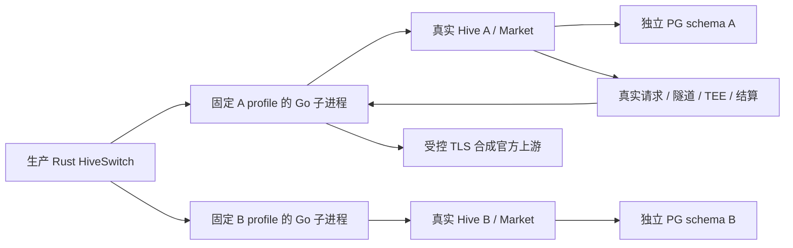

# Hive 切换：真实托管进程与任务验收

日期：2026-11-12（Asia/Shanghai）。本报告覆盖 09 的受管进程、真实任务及相关回归。Linux 原生 GUI 已由集成负责人完成并提交[独立记录](../2026-11-12-hive-switch-native/README.md)；最终全分支双轴审查仍由集成负责人收尾。

## 版本和边界

最终真实矩阵基于 Bee `4a1c2fce1ad32407617c22f36f805fa001b182b6`、Hive `6f702763525d8e9de1ad2eda42eb3f955f81e39b`。Bee 已合并集成 `e2afff5`（合并提交 `e43e52b`）。[manifest.json](manifest.json) 保存三个测试程序的 SHA-256；报告及快照提交在这些源码提交之后，不改变运行代码。

这条验收链实际运行生产 Rust `HiveSwitch`，由它启动固定 profile/mode 的生产 Go 桌面核心，再访问两个真实 Hive/Market 和独立 PostgreSQL schema。唯一供给设备由协调器管理；没有另启 CLI Bee 替代它。真实请求经过现有准入、隧道、TEE 证据和结算路径；没有插入或更新 execution 行来伪造任务完成。

官方账号、登录来源和官方 HTTPS 响应使用合成数据。测试关闭 keyring，将官方 HTTP transport 显式映射到 loopback 合成服务，CONNECT 代理只接受 `chatgpt.com:443` 并连接受控 TLS 上游。没有读取真实用户账号，也没有改写 HOME。该 seam 仅存在于测试代码；生产 origin 规则仍只允许回环地址使用 HTTP。此 Mac 测试使用专用 loopback PostgreSQL，不宣称它具有 Linux GUI 的 Docker 网络隔离证明。



## 直接结果

最终双侧 Go `-race` runner 四个子场景全部通过，共 36.13 秒。归档日志仅清除行尾空白和末尾空行，原始文件保留在 `/tmp/bee-hive-url-switching/native-final-race/`。完整输出在 [native.log](native.log)；`REAL_HIVE_SWITCH_ACCEPTANCE` 和 `REAL_HIVE_SWITCH_UNFINISHED` 行关联真实 request/device/switch 标识。

| 场景 | 实际证明 | 耗时 |
| --- | --- | --- |
| held | A 已接真实请求；首次 B 配对期间 A connected；drain 返回 executions=1，新请求 503；取消保留 A 和原任务；再次切换等待同一设备的原请求 settled，才停止/reap A、清 IPC、提交并释放 B；B 零账号；B→A 恢复选择、代理及供给 | 12.55s |
| held + release 响应丢失 | 真实 Hive 已接受 B release 后断开响应，原 status 暂时 503；停止 owned children、从同一私有存储重建协调器，switch/request/seal/release 保持；恢复原 GET 后完成，release POST 总数为 1；随后 B→A | 11.69s |
| unknown termination | 真实推理提供错误 TEE 签名，形成 unknown_terminations=1；A 保持当前，无 seal、无进程交接、无索引提交；新请求 503；取消后再次切换仍被相同事实阻止，并可取消退出 | 5.83s |
| unsettled | 真实请求的结算 INSERT 被专用测试 trigger 拒绝，形成 unsettled=1；同样阻止提前 seal/stop/commit，取消与重试保持事实 | 6.07s |

release 丢失场景退出时会出现 `PROFILE_MODE_RESTRICTED` 的普通 runtime_snapshot 诊断：activate 子进程没有普通页面读取权限。测试同时断言 owned 子进程停止和原 journal 保留，随后确实从原记录恢复成功；没有将该诊断隐藏为正常读取成功。

## 真实验收发现并修复的问题

| 问题与原失败证据 | 修复与通过证据 |
| --- | --- |
| 首次 B 配对将 Go 有效 network revision 重置为 1；prepare 子进程不能调用普通 network_status，Rust 仍要求 0，inspect 被严格验证器拒绝。原日志 `/tmp/bee-switch-09-native-red6.log`：`actual=1 required=0 action="inspect"` | `2e7618f` 仅允许 prepare/inspect 观察安全有效网络版本，并保存它；实例、绑定和后续 action 校验不放宽。协议测试先红后绿，最终四场景通过 |
| 取消 A 的活动任务时重复应用相同网络配置，被 Go 的运行态保护拒绝。原日志 `/tmp/bee-switch-09-native-green3.log` 为失败历史，文件名不表示通过 | Rust 先读可信有效网络状态；仅 revision 和 proxy 都完全一致才跳过重复 apply。真实 held cancel 通过 |
| 未 sealed 的取消 release 已返回 200，Go 仍等待整个连接生命周期持有的 connectionGate，Rust deadline 超时。原日志 `/tmp/bee-switch-09-native-green4.log` | 只有 sealed 回执需要 handoff；未封存取消保留原连接及任务。sealed 锁使用请求 ctx 并保留诊断。真实 held cancel 通过 |
| B activate 完成准入后转入普通 presence，但 inspect 只为 current mode 读取普通连接 lease；B→A 带空 lease 被 Hive 409 拒绝。原日志 `/tmp/bee-switch-09-native-green7.log`：`begin connection lease mismatch` | `c8af01f` 允许持久 AdmissionCompleted 的 activate 读取自身普通连接；prepare/未完成激活保持限制。最终两组 held 往返通过 |
| 目标首次配对表单为空，且初次配对完成误称重新绑定；英文切换反馈缺翻译。原生 GUI 发现，表单回归 `/tmp/bee-switch-09-target-form-red2.log` 先红 | `9a254fb` 使用 journal 的目标 origin 预填并只读，设备名保留；初次完成显示“设备已配对，未自动开始贡献。”；补全切换英文静态文案。新增回归及完整相关预览 10/10 通过 |

## 验证清单

| 检查 | 结果 | 保存的输出 |
| --- | --- | --- |
| 生产协调器 + 真实 Go/Hive/PG/任务矩阵，Bee/Hive `-race` | 4/4，36.13s | [native.log](native.log)、[manifest.json](manifest.json) |
| 完整 Rust lib | 350 passed，0 failed，6 ignored，81.91s；外部 native ignored 项已由上方 runner 单独执行 | [rust-full.log](rust-full.log) |
| Go DesktopSwitch race | PASS，1.990s | [go-switch-race.log](go-switch-race.log) |
| Hive 最终准入竞争、真实 unknown/unsettled、正常选供给回归 race | PASS，117.937s；普通市场 helper 的 CLI 仅为回归，不替代本票受管设备验收 | [hive-regression-race.log](hive-regression-race.log) |
| TypeScript | typecheck PASS；单元 342/342 | [typecheck.log](typecheck.log)、[ts-unit.log](ts-unit.log) |
| Hive 切换 Playwright | 10/10，7.6s | [preview-switch.log](preview-switch.log) |
| 生产前端构建 | PASS；既有大 chunk 提示仍在，无构建错误 | [production-build.log](production-build.log) |

Rust 完整结果还覆盖 19 个协调器和 17 个 profile/迁移测试，包括原 ID 查回、未知取消、查询预算重启、提交窗口、旧作用域响应、迁移每个持久阶段、旧入口 fence、冲突和证据保留。这些是故障注入/文件系统回归，不能表述为每个故障都已在真实 GUI 和真实 Hive 上单独实测。

复现时在 Bee 工作树运行（Go 1.27.3、Node 24、Rust 1.94，依赖使用锁定版本）：

```sh
TEST_DATABASE_URL='postgres://postgres@127.0.0.1:15440/postgres?sslmode=disable' \
python3 scripts/test-hive-switch-native.py \
  --hive /absolute/path/to/hive-with-6f70276 \
  --logs /tmp/hive-switch-native-repeat \
  --cargo-target /absolute/path/to/owned-cargo-target
```

runner 构建正式 sidecar、race Go bridge 程序、Rust lib 测试程序和 race Hive fixture，校验唯一 Rust executable 后运行外部 native 测试，最后写版本/二进制摘要。Hive 的既有 Bee 子模块必须按仓库 pin 初始化。实际本次 runner 的外层日志是 `/tmp/bee-switch-09-runner-final.log`，构建详情在 `/tmp/bee-hive-url-switching/native-final-race/`。

## UI 预览与原生 GUI 的分工

新完整 React 冻结包在 [20261112-232850-hive-switch-acceptance-fixes](../../../../desktop/tests/fixtures/bee-preview/history/20261112-232850-hive-switch-acceptance-fixes/SOURCE.md)，实际可打开入口与启动方式见 [历史索引](../../../../desktop/tests/fixtures/bee-preview/history/README.md)。本目录两个 `frozen-*.png` 是该前端 mock 的补充截图。冻结包独立 HTTP 根目录的关键交互由 ego-browser 检查：目标 URL 精确预填且 readOnly、提交后生成目标配对码、暗色窄窗口列表、Escape 关闭及输入保留。它不连接真实 Hive。

Linux 原生 GUI 使用真实 Tauri App、正式生产 Go 子进程、独立 Hive/PG 及合成空账号；[记录](../2026-11-12-hive-switch-native/README.md)和 [proof.json](../2026-11-12-hive-switch-native/proof.json)证明 A→首次 B→已保存 A、原 pending 崩溃后操作/预算/地址保留、取消恢复 A、Ctrl+Q 继续等待及取消退出后再次启动留 A、暗色 900×700 列表滚动和键盘焦点返回。最初误输入的 B 端口 `3685` 仅用于证明原操作/输入在崩溃后保留，不能算成功连上实际 B；实际 B 端口是 `34685`。

## 已知验证边界

- 没有使用真实官方账号；受控 TLS 上游不证明真实官方服务的可用性。
- 本票没有运行 Windows GUI 或 macOS 完整 GUI；Linux GUI 证据以相邻记录为准。
- begin/seal 全部响应丢失、每个本地保存/索引崩溃点、所有取消并发，主要由已有协调器/Hive 故障回归覆盖；本轮真实跨进程新增的是 held cancel、真实 B release 丢失/重启、unknown 和 unsettled，不能宣称已在真实链上穷举每个时序。
- 来源被另一 Hive 改变、地址别名和同 URL 数据库重建有作用域/凭据拒绝回归；没有宣称本轮真实 GUI 逐项操作了这些外部变化。
- 源 Hive 的单一 Market owner 部署前提保持不变，本报告不证明多实例分布式协调。
- 最终全分支标准/规格双轴审查与跨仓库集成完成状态由集成负责人给出；本报告提交时保留该闸门。
