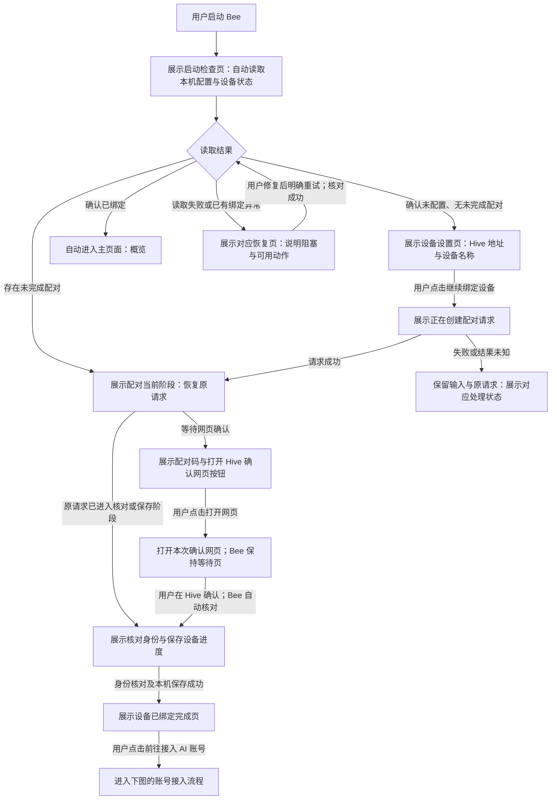
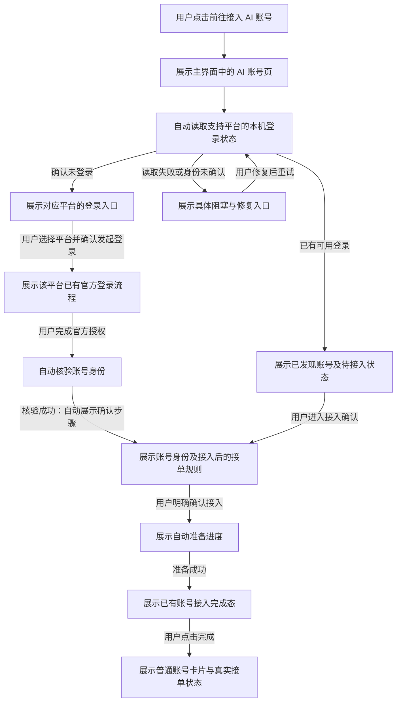

# Bee 首次启动向导

更新：2026-11-12，Asia/Shanghai。

状态：两步设备设置、手动填写 Hive 地址、绑定前禁止进入主页面已确认；以下拆分流程为待评审文本。尚未制作 HTML 或修改正式实现，不是实施计划。

## 现状与证据

- 正式入口为 `desktop/src/main.tsx` 中的 `NativeApp autoService`，默认进入概览。
- `desktop/src/features/overview/NativeOverviewPage.tsx` 将运行状态、准备步骤、设备配对及账号列表组合在概览中。
- `desktop/src/features/device/DevicePairingPage.tsx` 中 Hive 地址初始为空，示例地址仅为 placeholder；设备名称默认 Bee Desktop。填写后生成配对码，打开确认网页是独立用户操作。
- 配对期间自动核对，网页批准后仍须核对身份并保存本机配置，不能直接宣告绑定完成。
- 绑定后自动连接和开始贡献不同：`agent/desktop_auto_service_test.go` 的无账号场景为 waiting，可建立 presence 连接，但没有贡献运行。
- 现有 AI 账号接入规则见 [账号设计](accounts-preview-design.md)，主预览为静态模拟，不能作为正式实现验收依据。

## 已确认边界

1. 使用“连接 Hive → 绑定设备”两步任务向导；设备绑定完成后衔接已有 AI 账号接入页。
2. 手动填写 Hive 地址，不预填未经确认的公共服务地址。
3. 去掉“稍后设置”。绑定设备完成前，不进入主页面；设置、导航或重启不能绕过该门槛。仍须允许关闭应用，必要诊断在阻塞页面提供。
4. 读取失败不能视为首次使用；已有绑定失效不能伪装成全新设备。
5. 绑定成功不等于账号已接入或可接单，进入账号页也不等于同意接入。

## Bee 启动时的页面判断

触发条件：用户启动或重新启动 Bee。所有“自动”箭头均为读取事实或展示状态，不发起新的绑定、登录或账号接入。

- 本次向导完成时停留在完成页，不自动跳入账号页；“前往接入 AI 账号”是用户操作。
- 重新启动时若已经确认绑定成功，进入概览；未接入账号时展示前往接入的入口，不重新绑定。
- 配对过期、失败及结果未知停在对应阶段，沿用现有恢复约束。失败不前进，未知结果先核对原请求，不自动重复创建或兑换。
- 本图的“已绑定”只决定可进入主页面，不承诺当前网络、账号、额度等全部可用。

## 点击“前往接入 AI 账号”后的操作流程

触发条件：设备已绑定，用户明确点击“前往接入 AI 账号”。按钮只导航到 AI 账号页，不自动选择平台、发起登录或授权接入。

- 读取到账号只表示发现候选，不等于已接入。用户可以先查看不同平台；进入账号页本身不授权使用任何账号。
- 接入保持原有暂停／允许接单选择；仅在确认没有历史选择时默认允许，并在确认页告知准备完成后将自动接单。查询失败不视为无历史。
- 准备失败或核验失败停在对应恢复阶段；修复后继续原流程，不把失败跳成完成。
- 已有平台登录、账号接入、换号及完成反馈沿用既有方案；本图不新增一套登录步骤。
- 绑定前移除的是“稍后设置”。绑定完成页是否保留“稍后接入”尚未进一步确认；上述主路径不依赖此入口。

## 页面内容调整

- 第一步保留 Hive 地址、设备名称、说明和“继续绑定设备”，移除“稍后设置”。
- 第二步保留本次 Hive、设备名、配对码、有效期及打开／复制确认网址。等待期间自动核对，不要求用户反复点击刷新。
- 完成页展示已确认的设备、归属账号、Hive，以及“前往接入 AI 账号”。不使用“开始贡献”或“可接单”冒充绑定结果。
- 沿用 Bee 现有视觉规范；按钮有明确动作、键盘焦点可见，阶段变化可被辅助技术感知。

## 前后对比

| 项目 | 当前正式实现 | 本次方案 |
| --- | --- | --- |
| 未绑定启动 | 进入普通概览中的配对区域 | 独立设备设置向导，绑定前不能进入主页面 |
| 地址来源 | 用户填写，无默认服务 | 沿用，补清楚填写说明 |
| 打开确认网页 | 用户点击按钮 | 沿用，不混为自动跳转 |
| 绑定成功 | 概览中展示设备信息 | 本次向导展示完成页，由用户点击进入账号页 |
| 再次启动且已绑定 | 默认概览 | 概览，按实际账号状态提供下一步 |
| 账号接入 | 既有独立确认流程 | 复用；导航、读取、登录、确认接入分别表达 |

## 技术栈与待定边界

建议全部沿用仓库现有版本：Tauri API/CLI 2.12.4 承载桌面与原生调用，React 19.2.8、TypeScript 7.0.2、Radix UI 1.8.1 和 Tailwind 4.3.3 承载现有界面，Vite 8.2.4 / Node 24.x 用于构建，Rust/Tauri 与 Go sidecar 沿用现有绑定能力。不新增向导库，避免重复维护状态与组件。

上述为已存在技术栈事实及沿用建议，尚未单独获得本次技术方案确认；正式规格定稿时集中确认，不将产品 Q1/Q2 的同意解释为技术选型批准。

下一轮只需细化尚未确定的完成页次要出口及中断恢复交互。布局与流程认可后再制作 `docs/preview/draft.html`，本轮不更新已认可主预览。
