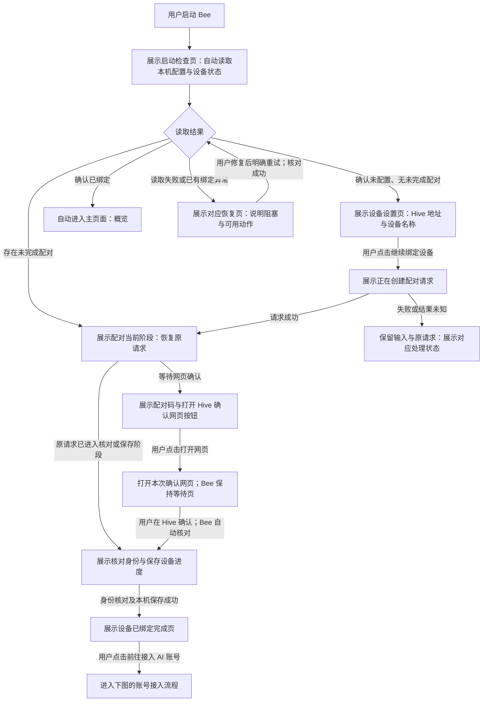
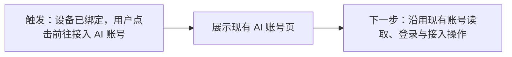

# Bee 首次启动向导

更新：2026-11-12，Asia/Shanghai。

状态：两步设备设置、手动填写 Hive 地址、绑定前禁止进入主页面已确认；账号页复用现有 App 实现已确认；向导线框、恢复方式、完成页“进入概览”、未提交草稿不保存及沿用技术栈均已确认。HTML 草稿已制作，视觉待评审；未修改正式实现，不是实施计划。

## 现状与证据

- 正式入口为 `desktop/src/main.tsx` 中的 `NativeApp autoService`，默认进入概览。
- `desktop/src/features/overview/NativeOverviewPage.tsx` 将运行状态、准备步骤、设备配对及账号列表组合在概览中。
- `desktop/src/features/device/DevicePairingPage.tsx` 中 Hive 地址初始为空，示例地址仅为 placeholder；设备名称默认 Bee Desktop。填写后生成配对码，打开确认网页是独立用户操作。
- 配对期间自动核对，网页批准后仍须核对身份并保存本机配置，不能直接宣告绑定完成。
- 绑定后自动连接和开始贡献不同：`agent/desktop_auto_service_test.go` 的无账号场景为 waiting，可建立 presence 连接，但没有贡献运行。
- 现有 AI 账号接入规则见 [账号设计](accounts-preview-design.md)，主预览为静态模拟，不能作为正式实现验收依据。

## 已确认边界

1. 使用“连接 Hive → 绑定设备”两步任务向导；设备绑定完成后衔接已有 AI 账号接入页。
2. 手动填写 Hive 地址，不预填未经确认的公共服务地址。
3. 去掉“稍后设置”。绑定设备完成前，不进入主页面；设置、导航或重启不能绕过该门槛。仍须允许关闭应用，必要诊断在阻塞页面提供。
4. 读取失败不能视为首次使用；已有绑定失效不能伪装成全新设备。
5. 绑定成功不等于账号已接入或可接单，进入账号页也不等于同意接入。

## Bee 启动时的页面判断

触发条件：用户启动或重新启动 Bee。所有“自动”箭头均为读取事实或展示状态，不发起新的绑定、登录或账号接入。



- 本次向导完成时停留在完成页，不自动跳入账号页；“前往接入 AI 账号”是用户操作。
- 重新启动时若已经确认绑定成功，进入概览；未接入账号时展示前往接入的入口，不重新绑定。
- 配对过期、失败及结果未知停在对应阶段，沿用现有恢复约束。失败不前进，未知结果先核对原请求，不自动重复创建或兑换。
- 本图的“已绑定”只决定可进入主页面，不承诺当前网络、账号、额度等全部可用。

## 点击“前往接入 AI 账号”后的操作流程（复用边界）

用户已确认本轮只设计设备绑定向导，账号页直接复用现有 App，不将其内部流程作为新增需求或重新送审。



按钮只导航，不自动选择平台、登录或接入账号。对应正式代码为 `desktop/src/features/accounts/NativeAccountsPage.tsx` 与 `useAccounts.ts`。已有实现不等于所有分支已经通过本轮真实验收；本次不重做账号页，也不将预览与正式 App 的差异纳入向导范围。

## 向导页面线框（已确认）

三个页面复用同一窗口和内容区域。绑定前隐藏主页面导航，无“稍后设置”；保留系统关闭窗口行为。沿用已有字体、颜色、控件及浅深色规则，不增加独立欢迎页。

### 第一步：填写地址与名称

```text
Bee

设置这台设备
① 连接 Hive ───── ② 绑定设备

Hive 地址
[ https://你的 Hive 地址                  ]
填写你要连接的 Hive 服务地址。

设备名称
[ Bee Desktop                           ]
用于在 Hive 中识别这台设备。

[继续绑定设备]
```

首次焦点位于 Hive 地址。字段校验失败就近说明原因并聚焦首个错误字段；提交后保留输入，主按钮显示“正在创建配对请求…”，阻止重复提交。成功进入第二步，不额外增加“测试连接”按钮。第一步完成只表示已成功创建配对请求，不代表已建立持续连接或可接单。

### 第二步：在网页确认

```text
Bee

设置这台设备
✓ 连接 Hive ───── ② 绑定设备

在 Hive 网页确认设备归属
Hive     用户填写的地址
设备     Bee Desktop

配对码   ABCD-EFGH                     [复制]
有效期   本次服务端返回的时间

[打开 Hive 确认网页]             复制确认网址

完成网页确认后回到 Bee，此处会自动更新。
```

配对码为线框示例。打开网页由用户触发；只打开原请求的有效网址，不重新生成配对。系统受理打开不等于网页加载成功，更不等于绑定成功。复制成功就地反馈，失败保留可手动选择的网址和配对码。

网页批准后，在同一区域展示“正在确认设备身份…”或“正在保存设备配置…”，只显示后台已确认的阶段，不猜进度、不用倒计时代替成功。保存完成后自动展示完成页，并将焦点移至结果标题；背景轮询不抢焦点。

### 完成页：设备已绑定

```text
Bee

设备已绑定
✓ 连接 Hive ───── ✓ 绑定设备

设备       Bee Desktop
归属账号   本次确认的 Hive 账号
Hive       本次绑定的地址

下一步：接入 AI 账号
接入后才能使用该账号参与贡献。

[前往接入 AI 账号]                    进入概览
```

主按钮打开现有账号页。次要按钮“进入概览”已确认：绑定已完成后允许先查看主页面，不要求立刻接入账号；它不替代或恢复已被否决的绑定前“稍后设置”。本页不自动跳转，也不把绑定成功表述为可接单。

## 中断与恢复（展示方式已确认）

| 触发事实 | 展示与下一步 |
| --- | --- |
| 创建前字段不合法 | 字段旁指出失败条件，保留其他输入，修正后由用户再次提交 |
| 创建请求已明确失败且允许重试 | 保留地址与名称，展示本次具体原因；用户修复后重试 |
| 创建结果未知且未取得配对凭据 | 保留原请求，说明尚无法确认创建结果；沿用现有 Hive 控制台核对及诊断入口，不提供重复生成按钮 |
| 打开网页失败 | 展示实际打开失败原因，允许再次打开同一有效网址或复制网址；不重建配对 |
| 本地计时到期但 Hive 未确认过期 | 显示正在核对有效性；不直接重新生成 |
| Hive 已确认配对码过期 | 显示过期事实，用户点击“重新生成配对码”后创建新请求 |
| 原事务核对或保存失败 | 展示实际失败条件及可见诊断证据，用户处理后点击“继续完成绑定”，检查已有绑定结果并继续保存；不重新兑换、不提前显示成功 |
| 关闭应用后重开，存在配对事务 | 自动读取并回到原阶段，不创建新请求；已完成绑定则进入概览 |
| 关闭应用时表单尚未提交 | 已确认不额外持久化草稿；重开仍从未配置页开始。与已提交事务的恢复明确区分 |

失败提示必须采用本次事实，原因未明就说明已知结果，不猜测网络、权限等互斥原因。主界面保留具体原因和处理动作，有额外证据才在错误原因旁提供圆圈叹号按钮（无障碍名称“查看错误详情”），点击打开与 AI 账号页同类的详情浮层，详情不暴露凭据。正常等待不常驻检查按钮，故障恢复按现有许可提供。

配对发起后不新增“返回修改 Hive”或“取消并重建”能力：现有状态不能证明原请求已安全终止，不能通过页面返回绕过。填写阶段可自由修改；进行阶段需要换目标 Hive 的安全退出能力不在本轮新增范围中。已有恢复中的旧设备排空、归属变化确认等特殊状态继续使用对应展示，不压缩成“等待网页确认”。

## 前后对比

| 项目 | 当前正式实现 | 本次方案 |
| --- | --- | --- |
| 未绑定启动 | 进入普通概览中的配对区域 | 独立设备设置向导，绑定前不能进入主页面 |
| 地址来源 | 用户填写，无默认服务 | 沿用，补清楚填写说明 |
| 打开确认网页 | 用户点击按钮 | 沿用，不混为自动跳转 |
| 绑定成功 | 概览中展示设备信息 | 本次向导展示完成页，由用户点击进入账号页 |
| 再次启动且已绑定 | 默认概览 | 概览，按实际账号状态提供下一步 |
| 账号接入 | 既有独立确认流程 | 复用；导航、读取、登录、确认接入分别表达 |

## 技术栈与待定边界

已确认全部沿用仓库现有版本：Tauri API/CLI 2.12.4 承载桌面与原生调用，React 19.2.8、TypeScript 7.0.2、Radix UI 1.8.1 和 Tailwind 4.3.3 承载现有界面，Vite 8.2.4 / Node 24.x 用于构建，Rust/Tauri 与 Go sidecar 沿用现有绑定能力。不新增向导库，避免重复维护状态与组件。

用户在本轮 Q3 集中确认中同意沿用上述技术栈，不新增向导库。

用户已同意 Q1–Q3，以上结论作为设计基线。待评审稿为 [draft.html](../preview/draft.html?scene=setup-form)，[完整冻结版](../preview/history/20261112-145209-first-launch-wizard/draft.html?scene=setup-form)。新增 17 个向导状态和 2 个绑定后入口，原有 462 个场景保留。本轮不更新已认可主预览。

外部网页授权、权限修复、配对结果与诊断记录均为预设模拟；真实协议与持久化未在本轮验收。直接选择进行中场景会停留，只有产品操作按预设推进。网页确认预设延时不代表真实产品自动批准绑定。


## 2026-11-12：错误入口与等待文案调整

- 用户要求故障详情参考 AI 账号页，使用圆圈叹号；主页面保留具体原因与修复动作，技术证据在浮层中展示。支持键盘打开、关闭、Escape、点击外部关闭和关闭后焦点返回；切场景移除旧浮层。
- 到期等待文案：“配对码有效期已到。Bee 正在向 Hive 确认最新状态，请稍等，结果会自动更新。”强调自动更新，不承诺成功或固定等待时间；服务端确认过期后仍由用户重新生成。
- 术语依据：[交互清晰度设计 §3.3](../superpowers/specs/2026-10-29-desktop-interaction-clarity-design.md) 已使用“重新检查设备”，不使用“重新核对设备”作为通用用户动作。
- 本向导保存失败的动作实际还会继续保存，因此采用“继续完成绑定”；配套说明“请恢复配置目录的写入权限，再点击‘继续完成绑定’。Bee 会检查已有绑定结果并继续保存。”启动读取失败保留“重新检查设备”，进行中使用“正在确认设备身份…”及“正在检查绑定结果并继续保存…”。这些是按动作明确含义，不将所有内部 reconciliation 统一改名。
- 预览直接选择等待场景仍停留供评审，自动更新为正式产品语义；场景选择器外的说明继续标明该模拟边界。
