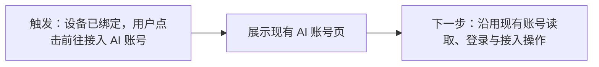

# Bee 首次启动向导 Spec

更新：2026-11-12，Asia/Shanghai。

状态：两步设备设置、手动填写 Hive 地址、绑定前禁止进入主页面已确认；账号页复用现有 App 实现已确认；向导线框、恢复方式、完成页“进入概览”、未提交草稿不保存及沿用技术栈均已确认。HTML 视觉已认可并纳入唯一主预览；正式实现合同已补齐，待评审；未修改正式实现，不是实施计划。

## 现状与证据

- 正式入口为 `desktop/src/main.tsx` 中的 `NativeApp autoService`，默认进入概览。
- `desktop/src/features/overview/NativeOverviewPage.tsx` 将运行状态、准备步骤、设备配对及账号列表组合在概览中。
- `desktop/src/features/device/DevicePairingPage.tsx` 中 Hive 地址初始为空，示例地址仅为 placeholder；设备名称默认 Bee Desktop。填写后生成配对码，打开确认网页是独立用户操作。
- 配对期间自动核对，网页批准后仍须核对身份并保存本机配置，不能直接宣告绑定完成。
- 绑定后自动连接和开始贡献不同：`agent/desktop_auto_service_test.go` 的无账号场景为 waiting，可建立 presence 连接，但没有贡献运行。
- 现有 AI 账号接入规则见 [账号设计](accounts-preview-design.md)，主预览为静态模拟，不能作为正式实现验收依据。

## 已确认边界

1. 使用“连接 Hive → 绑定设备”两步任务向导；设备绑定完成后衔接已有 AI 账号接入页。
2. 手动填写 Hive 地址，不预填未经确认的公共服务地址。
3. 去掉“稍后设置”。绑定设备完成前，不进入主页面；设置、导航或重启不能绕过该门槛。仍须允许关闭应用，必要诊断在阻塞页面提供。
4. 读取失败不能视为首次使用；已有绑定失效不能伪装成全新设备。
5. 绑定成功不等于账号已接入或可接单，进入账号页也不等于同意接入。

## Bee 启动时的页面判断

触发条件：用户启动或重新启动 Bee。自动启动检查不发起新的配对、登录或账号接入；对已获用户授权的持久化配对事务，状态检查可以继续兑换和保存。


- 本次向导完成时停留在完成页，不自动跳入账号页；“前往接入 AI 账号”是用户操作。
- 重新启动时若已经确认绑定成功，进入概览；未接入账号时展示前往接入的入口，不重新绑定。
- 配对过期、失败及结果未知停在对应阶段，沿用现有恢复约束。失败不前进，未知结果先核对原请求，不自动重复创建或兑换。
- 本图的“已绑定”只决定可进入主页面，不承诺当前网络、账号、额度等全部可用。

## 点击“前往接入 AI 账号”后的操作流程（复用边界）

用户已确认本轮只设计设备绑定向导，账号页直接复用现有 App，不将其内部流程作为新增需求或重新送审。



按钮只导航，不自动选择平台、登录或接入账号。对应正式代码为 `desktop/src/features/accounts/NativeAccountsPage.tsx` 与 `useAccounts.ts`。已有实现不等于所有分支已经通过本轮真实验收；本次不重做账号页，也不将预览与正式 App 的差异纳入向导范围。

## 向导页面线框（已确认）

三个页面复用同一窗口和内容区域。绑定前隐藏主页面导航，无“稍后设置”；保留系统关闭窗口行为。沿用已有字体、颜色、控件及浅深色规则，不增加独立欢迎页。

### 第一步：填写地址与名称

```text
Bee

设置这台设备
① 连接 Hive ───── ② 绑定设备

Hive 地址
[ https://你的 Hive 地址                  ]
填写你要连接的 Hive 服务地址。

设备名称
[ Bee Desktop                           ]
用于在 Hive 中识别这台设备。

[继续绑定设备]
```

首次焦点位于 Hive 地址。字段校验失败就近说明原因并聚焦首个错误字段；提交后保留输入，主按钮显示“正在创建配对请求…”，阻止重复提交。成功进入第二步，不额外增加“测试连接”按钮。第一步完成只表示已成功创建配对请求，不代表已建立持续连接或可接单。

### 第二步：在网页确认

```text
Bee

设置这台设备
✓ 连接 Hive ───── ② 绑定设备

在 Hive 网页确认设备归属
Hive     用户填写的地址
设备     Bee Desktop

配对码   ABCD-EFGH                     [复制]
有效期   本次服务端返回的时间

[打开 Hive 确认网页]             复制确认网址

完成网页确认后回到 Bee，此处会自动更新。
```

配对码为线框示例。打开网页由用户触发；只打开原请求的有效网址，不重新生成配对。系统受理打开不等于网页加载成功，更不等于绑定成功。复制成功就地反馈，失败保留可手动选择的网址和配对码。

网页批准后，在同一区域展示“正在确认设备身份…”或“正在保存设备配置…”，只显示后台已确认的阶段，不猜进度、不用倒计时代替成功。保存完成后自动展示完成页，并将焦点移至结果标题；背景轮询不抢焦点。

### 完成页：设备已绑定

```text
Bee

设备已绑定
✓ 连接 Hive ───── ✓ 绑定设备

设备       Bee Desktop
归属账号   本次确认的 Hive 账号
Hive       本次绑定的地址

下一步：接入 AI 账号
接入后才能使用该账号参与贡献。

[前往接入 AI 账号]                    进入概览
```

主按钮打开现有账号页。次要按钮“进入概览”已确认：绑定已完成后允许先查看主页面，不要求立刻接入账号；它不替代或恢复已被否决的绑定前“稍后设置”。本页不自动跳转，也不把绑定成功表述为可接单。

## 中断与恢复（展示方式已确认）

| 触发事实 | 展示与下一步 |
| --- | --- |
| 创建前字段不合法 | 字段旁指出失败条件，保留其他输入，修正后由用户再次提交 |
| 创建请求已明确失败且允许重试 | 保留地址与名称，展示本次具体原因；用户修复后重试 |
| 创建结果未知且未取得配对凭据 | 保留原请求，说明尚无法确认创建结果；沿用现有 Hive 控制台核对及诊断入口，不提供重复生成按钮 |
| 打开网页失败 | 展示实际打开失败原因，允许再次打开同一有效网址或复制网址；不重建配对 |
| 本地计时到期但 Hive 未确认过期 | 显示正在确认最新状态；不直接重新生成 |
| Hive 已确认配对码过期且允许替换、无未决兑换 | 显示过期事实，用户点击“重新生成配对码”后创建新请求 |
| 原事务核对或保存失败 | 展示实际失败条件及可见诊断证据，在协议允许续存时，用户处理后点击“继续完成绑定”，检查已有绑定结果并继续保存；不重新兑换、不提前显示成功 |
| 关闭应用后重开，存在配对事务 | 自动读取并回到原阶段，不创建新请求；已完成绑定则进入概览 |
| 关闭应用时表单尚未提交 | 已确认不额外持久化草稿；重开仍从未配置页开始。与已提交事务的恢复明确区分 |

失败提示必须采用本次事实，原因未明就说明已知结果，不猜测网络、权限等互斥原因。主界面保留具体原因和处理动作，有额外证据才在错误原因旁提供圆圈叹号按钮（无障碍名称“查看错误详情”），点击打开与 AI 账号页同类的详情浮层，详情不暴露凭据。正常等待不常驻检查按钮，故障恢复按现有许可提供。

配对发起后不新增“返回修改 Hive”或“取消并重建”能力：现有状态不能证明原请求已安全终止，不能通过页面返回绕过。填写阶段可自由修改；进行阶段需要换目标 Hive 的安全退出能力不在本轮新增范围中。已有恢复中的旧设备排空、归属变化确认等特殊状态继续使用对应展示，不压缩成“等待网页确认”。

## 前后对比

| 项目 | 当前正式实现 | 本次方案 |
| --- | --- | --- |
| 未绑定启动 | 进入普通概览中的配对区域 | 独立设备设置向导，绑定前不能进入主页面 |
| 地址来源 | 用户填写，无默认服务 | 沿用，补清楚填写说明 |
| 打开确认网页 | 用户点击按钮 | 沿用，不混为自动跳转 |
| 绑定成功 | 概览中展示设备信息 | 本次向导展示完成页，由用户点击进入账号页 |
| 再次启动且已绑定 | 默认概览 | 概览，按实际账号状态提供下一步 |
| 账号接入 | 既有独立确认流程 | 复用；导航、读取、登录、确认接入分别表达 |

## 技术栈与待定边界

已确认全部沿用仓库现有版本：Tauri API/CLI 2.12.4 承载桌面与原生调用，React 19.2.8、TypeScript 7.0.2、Radix UI 1.8.1 和 Tailwind 4.3.3 承载现有界面，Vite 8.2.4 / Node 24.x 用于构建，Rust/Tauri 与 Go sidecar 沿用现有绑定能力。不新增向导库，避免重复维护状态与组件。

用户在本轮 Q3 集中确认中同意沿用上述技术栈，不新增向导库。

用户已同意 Q1–Q3，以上结论作为设计基线，并于 2026-11-12 确认最新 HTML 纳入主预览。当前入口为 [index.html](../preview/index.html?scene=setup-form)，[完整冻结版](../preview/history/20261112-152533-approved-first-launch/index.html?scene=setup-form)。新增 17 个向导状态和 2 个绑定后入口，原有 462 个场景保留。

外部网页授权、权限修复、配对结果与诊断记录均为预设模拟；真实协议与持久化未在本轮验收。直接选择进行中场景会停留，只有产品操作按预设推进。网页确认预设延时不代表真实产品自动批准绑定。


## 2026-11-12：错误入口与等待文案调整

- 用户要求故障详情参考 AI 账号页，使用圆圈叹号；主页面保留具体原因与修复动作，技术证据在浮层中展示。支持键盘打开、关闭、Escape、点击外部关闭和关闭后焦点返回；切场景移除旧浮层。
- 到期等待文案：“配对码有效期已到。Bee 正在向 Hive 确认最新状态，请稍等，结果会自动更新。”强调自动更新，不承诺成功或固定等待时间；服务端确认过期后仍由用户重新生成。
- 术语依据：[交互清晰度设计 §3.3](../superpowers/specs/2026-10-29-desktop-interaction-clarity-design.md) 已使用“重新检查设备”，不使用“重新核对设备”作为通用用户动作。
- 本向导保存失败的动作实际还会继续保存，因此采用“继续完成绑定”；配套说明“请恢复配置目录的写入权限，再点击‘继续完成绑定’。Bee 会检查已有绑定结果并继续保存。”启动读取失败保留“重新检查设备”，进行中使用“正在确认设备身份…”及“正在检查绑定结果并继续保存…”。这些是按动作明确含义，不将所有内部 reconciliation 统一改名。
- 预览直接选择等待场景仍停留供评审，自动更新为正式产品语义；场景选择器外的说明继续标明该模拟边界。


## 正式实现合同（2026-11-12，待评审）

本节将已确认界面绑定到现有协议，作为后续 Plan 的实现依据。本设计取代 [2026-10-29 交互清晰度设计](../superpowers/specs/2026-10-29-desktop-interaction-clarity-design.md) 中“首次未绑定仍可访问主页面”的旧约定；该文档的其他恢复与账号规则继续适用。前文定义页面与用户动作，本节定义可信事实、恢复约束和验收条件。实现范围为 NativeApp 首次设置分流、向导及必要的状态适配；不重做 AI 账号页、不新增服务、协议、配对事务存储或轮询器，不改既有贡献授权规则。

### 启动判定与导航门槛

| 触发条件／可信事实 | 展示页面 | 下一步 |
| --- | --- | --- |
| 原生连接、配置或设备事实尚未读完 | 启动检查页 | 由现有协调器完成读取；不得短暂闪现填写页或主页面 |
| 配置损坏、权限失败、原生服务不可用或事务读取异常 | 对应恢复界面 | 展示本次原因及诊断／修复入口；不能解释成未配置 |
| 明确无配置、无恢复事务，并取得可信 unbound 状态 | 向导填写页 | 用户填写并点击“继续绑定设备” |
| 存在 initial_pairing 未完成事务 | 向导原阶段 | 自动续接原事务；需要明确授权的操作仍等用户点击 |
| 存在 credential_recovery 或已知旧绑定失效 | 既有设备恢复流程 | 保留原工作区恢复能力，不降级为全新设备设置 |
| 本会话参与的首次配对刚完成，尚未选择去向 | 向导完成页 | 等用户点击账号页或概览入口 |
| 首次可信观测已经绑定，且无待处理首次完成页 | 常规概览 | 沿用现有启动恢复、账号及运行状态展示 |

判定基于同一作用域的 context、device、recovery 与读取结果；空对象、暂时没有 device、偏好默认值或 device_id 为空都不足以证明首次使用。仅 typed absence（例如 DEVICE_CONTEXT_UNCONFIGURED、DEVICE_RECOVERY_NONE）可以表示对应资源不存在。已有恢复事务优先于普通设备展示；启动阻塞不得隐藏解决该阻塞所需的设备恢复入口。

首次未绑定门槛集中约束实际显示页面，覆盖侧栏、内部导航、通知与状态回切；只隐藏导航按钮不够。绑定前不得展示普通概览、账号或完整设置页。必要诊断与针对当前故障的修复控件在阻塞流程内可达，提供返回原阶段的路径，保留本会话已填内容；不能借修复入口开放常规主页面。已有绑定的恢复工作区不受首次向导的导航限制。

### 完成页与作用域

现有 NativeWorkspace 按 instance 与 bindingRevision 重挂载。首次事务的会话追踪及完成页待确认状态应由 NativeApp 或同等稳定容器持有，跨本次绑定 revision 变化保留；不新增持久化“已看过向导”标志。

完成条件为：原首次事务可关联到新绑定、身份与 Hive/设备/归属一致、本机配置已保存、当前 context 与 bound 结果属于同一作用域。网页批准、兑换成功或 saving 阶段本身都不满足条件。若保存已成功但响应丢失，先重新取得匹配证据再显示完成页。

本会话从磁盘恢复未完成首次事务后完成，也停留完成页；应用重启后首次读到已完成绑定直接概览。绑定撤销、替换、实例重启或事务冲突时，不沿用旧完成页数据，应重新判定；正常首次完成导致的 revision 变化不能误清待确认状态。旧异步回包不得切页、清除新错误或覆盖新身份。

### 单一协调器与原生调用

- 复用 `desktop/src/system/desktopState.ts` 的快照、刷新合并、退避和 epoch 隔离。向导不建立额外 status 定时器；服务端给出的轮询间隔由现有调度统一处理，不将 HTML 演示延时带入产品。
- `device_status` 可以推进已授权事务、兑换及保存，不能当作无副作用 GET 重复调用。调用后无论成功或失败都可能需要重新观测 context，沿用协调器既有逻辑。
- 首次配对使用 `device_begin`、`device_status`、`device_open`。`device_recovery_status/confirm` 服务于 credential_recovery，不能替代首次配对接口；首次事务从 DeviceView 的 recovery 读取。
- `device_begin` 只能由明确提交或协议允许的重试／重新生成触发；提交中的重复点击合并或禁用，重挂载、导航、刷新和恢复不隐式调用 begin。
- `device_open` 会先重新检查状态，可能返回已绑定或过期而没有启动浏览器。界面消费真实回执并刷新状态，不能将 Promise 成功一律提示为“浏览器已打开”。使用返回并经原生验证的同源配对网址，不在前端拼接路径。
- 完成页的两个入口只切换页面。账号页按既有 active 条件读取来源；不额外触发登录、账号选择、授权、runtime restore 或解除暂停。原有 AutoService/presence 行为保持，绑定不代表开始贡献。

### 配对阶段与许可动作

下表为协议到界面的映射，不新增协议状态；故障可叠加在原阶段上。

| 阶段／事实 | 用户展示 | 可执行动作与限制 |
| --- | --- | --- |
| awaiting_confirmation，确认创建尚未尝试 | 保留地址、名称及创建前检查失败原因 | 用户处理后明确重试 begin；状态读取不能代为首次提交 |
| creating | 正在创建配对请求 | 禁用重复提交，等待原请求结果 |
| creation_unknown | 无法确认配对请求是否创建成功 | 检查已有身份、前往现有 Hive 控制台及诊断；无配对 token 时不得再创建。后续可信身份仍可证明成功 |
| pending | 配对码、有效期、网页确认入口 | 打开或复制原有效网址；由协调器检查进展 |
| draining | 等待已有设备连接结束的实际状态 | 沿用原等待与恢复能力，不能伪装成等待用户网页确认 |
| redeeming | 正在确认设备身份… | 等待原兑换，不重复提交 |
| redemption_unknown | 尚未确认绑定结果 | 检查原凭据身份；不能再次兑换或重新生成 |
| awaiting_owner_confirmation | 展示实际归属变化及原确认要求 | 仅使用该事务已有且目的匹配的确认能力；初始事务若不支持该阶段则作为异常，不能借凭据恢复接口强行通过 |
| saving | 正在保存设备配置… | 保存失败时保留原因；可恢复时由“继续完成绑定”检查原身份并续存，不再次兑换 |
| expired | Hive 已确认过期 | 仅在后端允许替换且无未决兑换时，由用户点击重新生成 |
| blocked／未知或矛盾状态 | 展示具体阻塞及诊断入口 | 不提供无法证明安全的重试，不静默退回填写页 |
| completed 且完成证据齐全 | 设备已绑定 | 按会话规则停完成页或重启进入概览 |

HTTP 状态码不是重试许可：创建 POST 之前的身份 GET 失败（含 503）可在确认尚未创建后明确重试；创建 POST 已尝试后的错误（包括 503、超时或响应验证失败）进入 creation_unknown，不重发。前端不能根据“网络错误”或错误文案推导可重建。

配对码本地计时归零只切换等待说明；Hive 的 `410 / pairing_expired` 才提供过期证据，仍须同时遵守未决兑换约束。等待文案“结果会自动更新”仅在确有自动检查时展示；调度停止、退避或检查失败时展示实际状态及可用恢复动作，不持续暗示正在进行网络请求。沿用现有启动恢复的长等待提示机制，不另加无限重试。

### 输入、错误与可访问性

Hive 地址沿用 `agent/client.go` 的 origin 校验：远程 HTTPS，仅回环地址允许 HTTP；不允许用户信息、查询串、片段或非根路径，根斜杠按现有规则归一化。设备名称去除首尾空白后为 1–80 个 Unicode 字符，禁止控制字符。前端就近提示，后端仍为最终校验依据；不得因预览放宽输入而放宽真实策略。

错误展示保留失败环节、实际原因及已有时间／错误码等可用证据，圆圈叹号只展开补充详情，不隐藏主要原因与修复动作。配置写权限修复指引只用于有写权限失败证据的场景；其他保存错误按实际原因说明，不统一猜测为权限不足。配对令牌、设备凭据及授权秘密不得进入详情、日志或导航参数。

沿用前文已认可的焦点、键盘、浮层规则。窄窗口可滚动，完整保留字段、错误及动作；浅深色均可辨认。进行中反馈可被辅助技术感知，自动刷新不反复播报整页，也不抢用户焦点。

### 技术栈确认记录

所有选型沿用且已确认，无新增依赖、服务或待确认版本升级。

| 技术 | 版本依据 | 用途与沿用理由 |
| --- | --- | --- |
| React / TypeScript | 19.2.8 / 7.0.2 | 现有 NativeApp 与类型化状态消费，无第二套界面框架 |
| Radix UI / Tailwind / Lucide | 1.8.1 / 4.3.3 / 1.43.0 | 复用现有控件、主题和错误详情图标，保持视觉与无障碍交互一致 |
| Tauri API / CLI | 2.12.4 | 复用现有原生桥及受控浏览器打开能力 |
| Rust / Go | 仓库现有 Rust 工具链约束、Go 1.27.3 | 复用状态校验、持久化与配对事务，不新增事务引擎 |
| Vite / Node | 8.2.4 / 24.x | 沿用构建环境 |
| Playwright / Node test / Go test | Playwright 1.63.0，其余随现有工具链 | 验证真实组件、桥接调用与事务故障行为 |

### 验收矩阵

以下是实施验收要求，不表示本轮已经通过。HTML 场景只能验证表现，不能代替真实 React、原生桥及 Go 事务测试。

| 场景 | 必须证明的行为 |
| --- | --- |
| 全新启动、慢读取、损坏／不可读配置 | 只有可信空配置进入填写页；其余显示检查或实际故障，不误建新设备 |
| 有未完成首次事务后重启 | 回到原阶段，create/redeem 次数不因恢复增加；未提交表单不持久化 |
| 创建前身份检查 503 与创建 POST 503 | 前者重试前 POST 为零；后者重启／连点后最多原一次创建尝试，不提供重建 |
| 网页批准与兑换结果未知 | 批准不直接完成；未知只检查原结果，不重复兑换 |
| 本地到期、Hive 确认过期、未决兑换 | 只有符合服务端与事务前提时允许明确重新生成 |
| 初次绑定保存失败及恢复 | 保留实际证据；继续原保存，create/redeem 不重复；须补首次配对专用覆盖，不能只依靠凭据恢复测试 |
| 保存成功但响应失败、绑定 revision 变化 | 重读后同作用域证据一致；本会话完成页不被重挂载跳过；重启已绑定进入概览 |
| 侧栏、通知、内部链接与诊断往返 | 初始未绑定不能绕过门槛；诊断返回保留输入／阶段；旧绑定恢复工作区不退化 |
| 绑定替换、旧响应晚到、实例重启 | 旧事务不能污染新作用域、展示旧成功页或重复写入 |
| 打开浏览器失败／超时、打开前已过期或完成 | 使用真实回执；不假报网页已打开；只在原网址仍有效时允许重开／复制 |
| 完成页点击账号页／概览 | 只有导航，无新增授权、贡献或 restore；既有账号接入与恢复测试保持通过 |
| 键盘、错误详情、窄窗口、浅深色 | 焦点可见、Escape 关闭并返回触发按钮、状态反馈可感知、主要错误与动作始终可见 |

现有回归依据包括 `desktop/tests/desktopState.test.ts`、`startup-recovery.test.ts`、`device.test.ts`、`device-recovery.spec.ts`、`native-auto-service.spec.ts` 及 `agent/desktop_device_recovery_test.go`。原 demo 的 onboarding 测试不是新 NativeApp 向导的覆盖证据。

### 预览与真实合同的差异记录

主预览的视觉与文案继续为已确认基线。本轮不改 HTML 或冻结历史。后续实施按本节合同修正模拟假设：

1. 预览宽泛的 HTTP(S) 校验不能作为真实输入规则；远程 Hive 必须 HTTPS。
2. 预览示例 `/device/confirm` 不代表协议地址；正式应用使用返回的 `/devices/pair?code=…` 同源网址，不自行拼接。
3. “创建失败可重试”的 503 示例必须明确为创建前身份检查失败；已尝试创建 POST 的 503 应呈现结果未知。
4. `save-failed` 等场景名不是协议 phase；保存错误依附原阶段，恢复许可由协议事实决定。

本轮仅完成源码核对与书面合同，未运行产品测试。正式实现及以上验收在 spec 确认后编写的 Plan 中安排。
