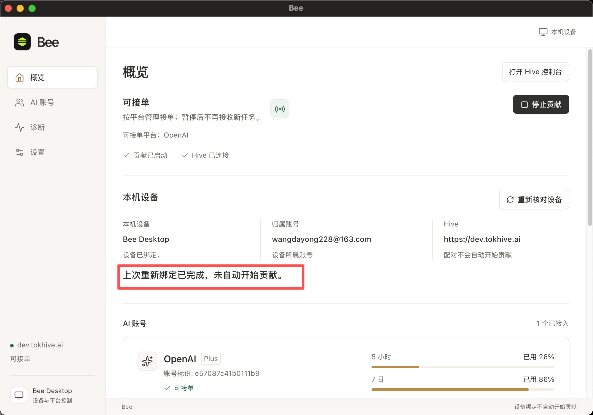

# 问题备忘

## 2026-11-03｜概览页持续显示历史绑定完成提示

- **位置：** Bee 桌面 → 概览 → 本机设备。
- **问题现象：** 设备已绑定，页面上方已显示“贡献已启动”“Hive 已连接”及“可接单”，本机设备区域仍持续显示“上次重新绑定已完成，未自动开始贡献。”。
- **用户影响：** 历史操作结果长期留在当前状态页面，容易让用户误以为贡献尚未开始，与上方运行状态产生理解冲突。

