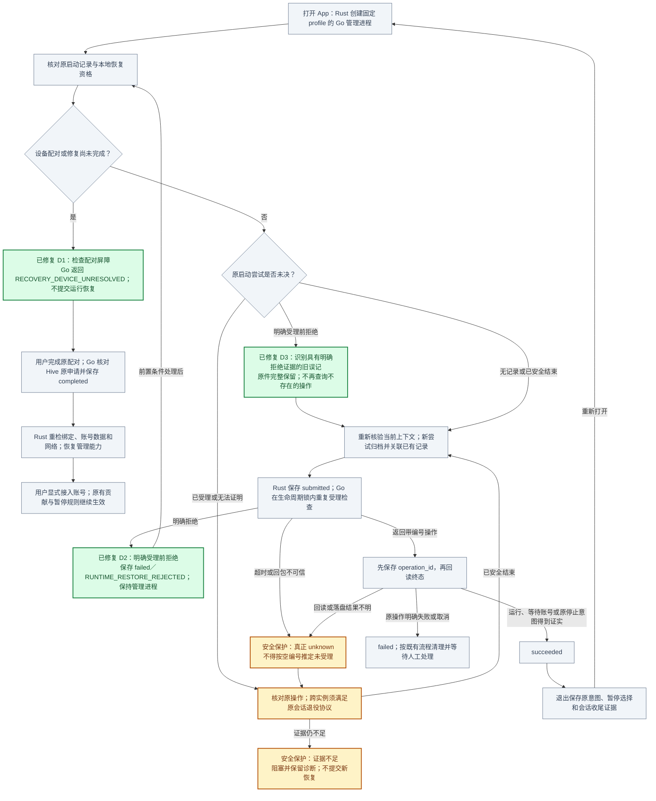

# 启动受理与配对衔接

2026-11-20（Asia/Shanghai）。适用范围：打开 App → 设备配对／修复 → 启动核验 → 退出／重启。沿用已认可的自动恢复、显式接入和暂停规则；不新增依赖、界面或业务授权。

## 修复前后对照

图例：**红色「原问题」**表示旧版错误行为，**绿色「已修复」**表示本次修改，**橙色「安全保护」**表示必须继续阻塞的真正未知结果，灰色表示既有正常步骤。每个节点同时有文字标签，颜色不是唯一识别方式。D1／D2／D3 与下方验收表对应；虚线仅表示修复对应关系，不表示运行时调用。

```mermaid
flowchart TB
    subgraph D1["D1：配对尚未完成时，启动检查怎么处理？"]
        direction LR
        O1["原问题 D1<br/>检查漏掉配对屏障，返回 idle<br/>随后提交 Restore，才被 Go 拒绝"]
        F1["已修复 D1<br/>检查设备配对／修复屏障<br/>未完成就返回 blocked，不创建启动尝试"]
        O1 -. 修复为 .-> F1
    end
    subgraph D2["D2：检查后发生变化，Restore 明确拒绝时怎么记？"]
        direction LR
        O2["原问题 D2<br/>运行操作尚未创建，已有明确拒绝回包<br/>Rust 却保存 unknown，并进入失败清理"]
        F2["已修复 D2<br/>保存 failed／RUNTIME_RESTORE_REJECTED<br/>保留原错误和管理进程，不对不存在的 worker 执行 Stop"]
        O2 -. 修复为 .-> F2
    end
    subgraph D3["D3：配对已经完成，旧错误记录如何收尾？"]
        direction LR
        O3["原问题 D3<br/>旧 journal 仍是 unknown，operation_id 为空<br/>持续查询不存在的运行操作，重启仍阻塞"]
        F3["已修复 D3<br/>依据明确受理前拒绝证据识别旧误记<br/>重检当前条件；新启动关联并原样归档旧记录"]
        O3 -. 修复为 .-> F3
    end
    S["安全保护仍生效<br/>只有空编号、超时或回包丢失，不能证明未受理<br/>继续核对原操作；证据不足时保持阻塞"]
    classDef old fill:#fee2e2,stroke:#b91c1c,color:#7f1d1d,stroke-width:2px;
    classDef fixed fill:#dcfce7,stroke:#15803d,color:#14532d,stroke-width:2px;
    classDef guard fill:#fef3c7,stroke:#b45309,color:#78350f,stroke-width:2px;
    class O1,O2,O3 old;
    class F1,F2,F3 fixed;
    class S guard;
```

## 修复后的完整流程与责任

下图绿色节点标明本次具体修复点；正常的失败处理不是旧问题，使用灰色或橙色表示。

已核实的源码边界：

- `agent/desktop_runtime.go:beginStartLocked` 在设备恢复屏障、生命周期、修订和账号动作检查通过后才创建 operation／run、预留会话并启动 worker。返回非空 error 的分支均在该边界之前；预留或 worker 失败通过已受理 operation 的终态返回。
- `desktopbridge/runtime.go:runtimeResult` 和 `server.go` 将 Restore 的返回错误封装为 `RUNTIME_OPERATION_FAILED`。Rust 先验证相关 IPC 响应，再处理业务错误。
- `desktop/src-tauri/src/runtime.rs:restore_with_progress` 保存受理编号后才查询运行快照。因此在该调用路径保存的“无编号＋明确 Restore 拒绝”与“无编号＋响应丢失”有不同证据。
- `agent/desktop_recovery_inspection.go` 只读设备恢复记录并复用受理屏障；读取不会推进配对、兑换或创建会话。真正受理仍重复检查，检查通过不是授权票据。
- `experience.rs:recover_device`／`recheck_binding` 在配对完成后重新检查；只恢复管理能力和设备在线维护，不调用 runtime_restore，也不解除暂停。下次 App 启动由正常恢复协调器检查当前持久意图。

## 状态与协议约定

| 事实／状态 | 所有者与完成证据 | 重试、重启和收尾 |
| --- | --- | --- |
| 设备配对未完成 | Go 的 `bee-desktop-recovery.json`；Hive 原申请结果及本地 completed 保存共同确定完成 | 原设备流程负责续办；启动检查不提交恢复、不生成替代配对 |
| 启动检查明确阻塞 | Go 返回具体检查错误；Rust 尚未写 submitted | 前置条件处理后重新检查，不消耗已受理恢复次数 |
| Restore 受理前拒绝 | 当前相关 IPC 回包 `RUNTIME_OPERATION_FAILED`，运行编号未生成 | Rust 保存 failed／RUNTIME_RESTORE_REJECTED；原因保留，不执行 runtime_stop；后续必须重新检查资格 |
| 旧版误记 unknown 的拒绝 | 原 schema 中 phase=unknown、operation_id=null、failure.code=RUNTIME_OPERATION_FAILED；调用边界如上 | 不改写原件、不伪造运行结果。观察不查询不存在的操作；合格新尝试关联 previous_attempt_id 并完整归档原件 |
| 真正 submitted／unknown | 缺少可信相关拒绝，或已存在 operation_id | 沿原实例、绑定、网络、操作编号查询；跨实例沿原会话退役协议，不换编号重放 |
| 已受理失败／取消 | 同操作编号的 failed／cancelled 回执 | 保留已确认终态；继续既有清理、人工重试预算，不适用受理前例外 |
| 成功与退出 | 当前上下文、运行／等待／停止状态及 owned-exit 回执 | 不覆盖暂停选择；新尝试归档前次记录，旧 worker 必须已受控结束 |

旧拒绝的识别不依赖其英文 message；仅凭 `operation_id=null`、当前 idle 或当前配对 completed 都不足以认定未执行。损坏记录仍阻塞。旧拒绝不需要会话退役证明，因为没有创建该次运行会话；若当前另有脏会话，当前恢复检查仍要求它的退役证明。

## 差异与验收映射

| 编号 | 原实现差异 | 修复与对应测试 |
| --- | --- | --- |
| D1 | 检查返回 idle，但 Restore 因 pending 配对拒绝 | 复用设备写屏障；`TestDesktopRecoveryInspectionBlocksPendingPairingBeforeRestore` 覆盖真实配对、期间关闭重建及完成后重建 |
| D2 | 明确拒绝被写为 unknown，随后等待不存在的操作 | 明确拒绝保存 failed；`restore_admission_refusal_keeps_management_without_stopping_and_allows_recheck` 覆盖检查后拒绝、无错误 Stop、手动核对与重试 |
| D3 | 配对完成后旧拒绝仍阻塞观察及新实例启动 | 原样保留并识别旧证据；`startup_continues_after_legacy_pairing_admission_rejection` 覆盖同／异实例和归档；`completed_pairing_rechecks_legacy_refusal_without_restoring_contribution` 覆盖管理重检 |
| D4 | 仅测局部检查可能遗漏跨语言实际错误包装 | `native_pairing_admission_recovery_through_real_go` 使用真实 Rust Bridge、Go transport、设备及运行服务，受控 Hive 完成配对；旧 Rust 的误记行为由测试明确种入 |
| 安全边界 | 无编号不证明未受理；已有暂停不能被恢复覆盖 | `missing_operation_alone_never_proves_admission_rejection`、既有 unknown／retirement／exit 测试和 `native_auto_service_through_real_go_transport_and_controlled_hive` |

测试结果和真实 App 验收属于每次执行的证据；本文件定义行为，不以测试名称或构建成功代替实际验收。历史执行记录保存于独立 `bee-design-archive`。
